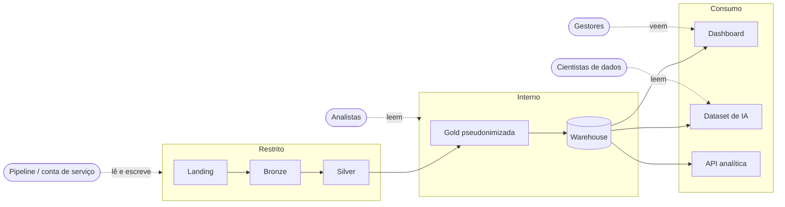
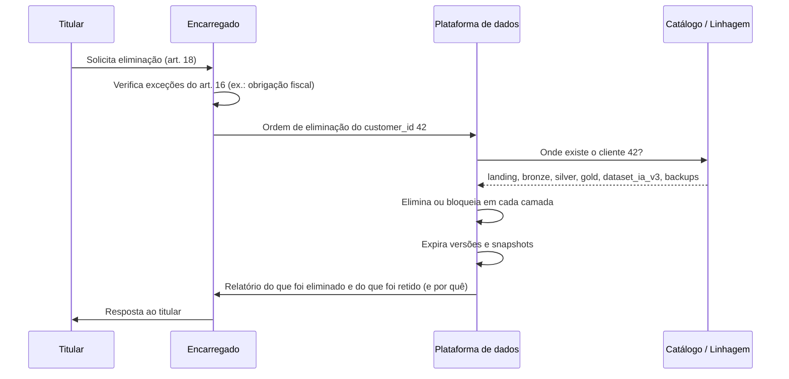

# Aula — Segurança, Privacidade e LGPD em Plataformas de Dados

## Conteúdo técnico da aula

**Tema:** proteção de dados pessoais, LGPD, classificação de dados, desidentificação (mascaramento, pseudonimização e anonimização), controle de acesso, criptografia, auditoria e ciclo de vida do dado em Data Lakes e Data Warehouses  
**Duração:** 2 horas  
**Formato:** aula teórica com discussão guiada e exemplos curtos  
**Cenário:** uma organização que já possui Data Lake, camadas Bronze/Silver/Gold e Data Warehouse. Antes de abrir os dados para dashboards, modelos de IA e APIs, precisa decidir **quem pode ver o quê, por quanto tempo e para qual finalidade**  
**Pré-requisitos:** noções de ingestão de dados, arquitetura medalhão, qualidade de dados e Data Warehouse

---

## 1. Resultado esperado da aula

Ao final, o aluno deverá ser capaz de:

1. diferenciar **segurança da informação**, **privacidade** e **proteção de dados pessoais**;
2. explicar os conceitos centrais da **LGPD** que afetam o trabalho de engenharia de dados;
3. classificar colunas em **identificadores diretos**, **quase-identificadores**, **dados sensíveis** e **dados não pessoais**;
4. diferenciar **mascaramento**, **pseudonimização** e **anonimização**, e explicar por que um *hash* simples não anonimiza;
5. explicar **k-anonimato** e os limites das técnicas de anonimização;
6. aplicar os princípios de **menor privilégio** e **separação por camada** no controle de acesso;
7. explicar o problema da **eliminação de dados** em um Data Lake imutável;
8. relacionar **privacy by design** com decisões concretas de arquitetura.

> **Mensagem central:** ingestão garante que o dado **chega**; qualidade garante que ele **merece confiança**. Proteção de dados garante que ele **só é visto e usado por quem deve, para o que deve e pelo tempo que deve**.

---

## 2. Roteiro sugerido

| Bloco | Conteúdo | Tempo |
| --- | --- | ---: |
| 1 | Por que uma plataforma de dados amplia o risco | 10 min |
| 2 | Segurança, privacidade e proteção de dados | 10 min |
| 3 | LGPD para engenheiros de dados | 25 min |
| 4 | Classificação e inventário de dados | 15 min |
| 5 | Desidentificação: mascarar, pseudonimizar, anonimizar | 25 min |
| 6 | Controle de acesso, criptografia e auditoria | 15 min |
| 7 | Ciclo de vida: retenção e eliminação no Lake | 15 min |
| 8 | Privacy by design e encerramento | 5 min |

O bloco de desidentificação é o mais longo de propósito: é onde mais aparecem **falsas sensações de segurança**.

---

## 3. Por que uma plataforma de dados amplia o risco

### 3.1 O efeito colateral do que construímos

Uma plataforma de dados resolve o problema de **dados espalhados**. Mas a solução cria um efeito colateral:

```text
Antes:  dados pessoais em 1 sistema de vendas, acessado por poucas pessoas
Depois: os mesmos dados em Landing, Bronze, Silver, Gold, Warehouse,
        dashboard, dataset de IA e API — acessados por muito mais gente
```

Toda plataforma analítica faz três coisas que aumentam o risco:

| O que a plataforma faz | Por que é bom | Por que é arriscado |
| --- | --- | --- |
| **Concentra** dados de várias fontes | Visão integrada do cliente | Um único vazamento expõe tudo |
| **Copia** o dado em várias camadas | Histórico e reprocessamento | Cada cópia precisa ser protegida e, um dia, apagada |
| **Cruza** fontes diferentes | Respostas de negócio | Cruzamentos podem reidentificar pessoas |

> **Pergunta para a turma:** se o e-mail de um cliente está no banco transacional de origem, quantas cópias dele existem em uma plataforma de dados típica?

Resposta provável: na Landing (arquivo bruto), na Bronze (Parquet), na Silver (Parquet), possivelmente na Gold e no Warehouse, e em qualquer CSV que alguém tenha exportado "só para testar". **Cada cópia é uma responsabilidade.**

### 3.2 Dado pessoal está em mais lugares do que parece

Nem todo dado pessoal tem cara de dado pessoal:

| Tabela (exemplo de e-commerce) | Dado pessoal evidente | Dado pessoal escondido |
| --- | --- | --- |
| `customers` | `name`, `email` | `state` + `created_at` combinados |
| `orders` | — | `customer_id` liga o pedido a uma pessoa |
| Eventos de navegação | — | sessão, pesquisas, horários: revelam hábitos |
| Entregas (API) | endereço de entrega | horário de recebimento: revela rotina da casa |

---

## 4. Segurança, privacidade e proteção de dados

Os três termos são usados como sinônimos, mas não são.

| Conceito | Pergunta central | Exemplo |
| --- | --- | --- |
| **Segurança da informação** | O dado está protegido contra acesso, alteração ou perda indevidos? | Bucket do Data Lake exige credencial |
| **Privacidade** | O indivíduo tem controle sobre informações a seu respeito? | Cliente sabe que seu histórico de navegação é usado para recomendação |
| **Proteção de dados pessoais** | O tratamento segue regras legais, com finalidade e limites? | A empresa tem base legal para usar o histórico e apaga quando deixa de precisar |

### 4.1 A tríade CID

A segurança da informação é tradicionalmente descrita pela tríade **CID** (em inglês, *CIA*):

- **Confidencialidade:** só quem está autorizado acessa;
- **Integridade:** o dado não é alterado indevidamente;
- **Disponibilidade:** o dado está acessível quando necessário.

Os estudos de qualidade de dados tratam da **integridade** sob o ponto de vista de correção. Aqui o foco é sobretudo **confidencialidade**.

### 4.2 Segurança é necessária, mas não suficiente

Um sistema pode ser perfeitamente seguro e, ainda assim, violar a privacidade:

> Uma loja virtual guarda o histórico de navegação em um bucket criptografado, com acesso restrito e auditado. Tecnicamente, é seguro. Mas se esse histórico for usado para inferir condição de saúde do cliente (compras em farmácia, pesquisas por sintomas) sem base legal e sem transparência, há um problema de **proteção de dados**, não de segurança.

---

## 5. LGPD para engenheiros de dados

A **Lei Geral de Proteção de Dados Pessoais** é a **Lei nº 13.709/2018**. Esta seção não substitui orientação jurídica. O objetivo é mostrar **quais conceitos da lei viram decisões técnicas**.

> **Atualização institucional:** a autoridade fiscalizadora, a **ANPD**, passou a ser a **Agência Nacional de Proteção de Dados** (MP nº 1.317/2025, convertida na Lei nº 15.352/2026). A sigla foi mantida.

### 5.1 Definições que importam (art. 5º)

| Termo | Definição legal (resumida ou literal) | Consequência técnica |
| --- | --- | --- |
| **Dado pessoal** (inciso I) | "informação relacionada a pessoa natural identificada ou identificável" | *Identificável* inclui quem pode ser descoberto por cruzamento. `customer_id` é dado pessoal. |
| **Dado pessoal sensível** (inciso II) | Origem racial ou étnica, convicção religiosa, opinião política, filiação sindical ou organização religiosa, filosófica ou política, saúde, vida sexual, dado genético ou biométrico | Regras mais rígidas (art. 11). Deve ser identificado e isolado. |
| **Dado anonimizado** (inciso III) | Relativo a titular que não possa ser identificado, "considerando a utilização de meios técnicos razoáveis e disponíveis na ocasião de seu tratamento" | O teste é **contextual e temporal**: o que é anônimo hoje pode deixar de ser amanhã. |
| **Titular** | Pessoa natural a quem os dados se referem | O cliente de uma loja virtual. |
| **Controlador** | Quem toma as decisões sobre o tratamento | A empresa que coleta e usa os dados. |
| **Operador** | Quem trata dados em nome do controlador | Ex.: um provedor de nuvem ou uma consultoria que roda o pipeline. |
| **Encarregado** (DPO) | Canal de comunicação entre controlador, titulares e ANPD | A pessoa que a engenharia consulta antes de criar um novo uso. |
| **Tratamento** | Toda operação com dados pessoais: coleta, armazenamento, cópia, transformação, eliminação… | **Todo pipeline que toca dado pessoal é tratamento.** Inclusive a Bronze. |

### 5.2 Os princípios do art. 6º traduzidos para engenharia

O art. 6º lista dez princípios, além da boa-fé. Vários deles se traduzem diretamente em requisitos de pipeline:

| Princípio | O que a lei pede | Como isso aparece na plataforma |
| --- | --- | --- |
| **Finalidade** | Propósitos legítimos, específicos e informados ao titular | Cada dataset documenta *para que* existe. "Pode ser útil um dia" não é finalidade. |
| **Adequação** | Compatibilidade do tratamento com a finalidade | O dado coletado para entrega não é reutilizado livremente para marketing. |
| **Necessidade** | Mínimo necessário: dados pertinentes, proporcionais e não excessivos | **Minimização**: o dataset de IA não precisa de nome nem e-mail. A Gold não precisa de `email`. |
| **Livre acesso** | Titular consulta como e por quanto tempo seus dados são tratados | A plataforma precisa conseguir responder "onde estão os dados do cliente X?". |
| **Qualidade dos dados** | Exatidão, clareza, relevância e atualização | Aula de qualidade: correção de dados também é obrigação legal. |
| **Transparência** | Informação clara sobre o tratamento | Catálogo e documentação dos datasets. |
| **Segurança** | Medidas técnicas e administrativas contra acessos não autorizados e incidentes | Controle de acesso, criptografia, auditoria. |
| **Prevenção** | Evitar danos antes que ocorram | Desidentificar **antes** de disponibilizar, e não depois de um incidente. |
| **Não discriminação** | Vedado tratamento para fins discriminatórios ilícitos ou abusivos | Atenção a modelos de IA que usam variáveis sensíveis ou suas proxies. |
| **Responsabilização e prestação de contas** | Demonstrar que as medidas foram adotadas e são eficazes | Logs, linhagem, relatórios. **O que não está registrado não pode ser demonstrado.** |

> **Ponto de atenção:** o princípio da **necessidade** é o que mais conflita com a cultura de Data Lake, que historicamente incentivou "guardar tudo, porque um dia pode ser útil". A LGPD exige o raciocínio oposto.

### 5.3 Bases legais (art. 7º)

Todo tratamento de dado pessoal precisa de uma **base legal**. O consentimento é apenas uma delas. Entre as hipóteses do art. 7º estão, por exemplo:

- consentimento do titular;
- cumprimento de obrigação legal ou regulatória;
- execução de contrato do qual o titular seja parte;
- exercício regular de direitos em processo;
- legítimo interesse do controlador ou de terceiro;
- proteção do crédito.

**Por que isso importa para quem constrói pipelines:** a base legal define o que pode ser feito com o dado.

> Exemplo: o endereço do cliente é tratado para **executar o contrato** (entregar o pedido). Usar esse endereço para um modelo de segmentação geográfica de marketing é **outra finalidade**, que pode exigir outra base legal. A engenharia não decide isso sozinha, mas precisa **registrar a finalidade de cada dataset** para que a decisão possa ser tomada.

Dados sensíveis seguem hipóteses próprias e mais restritas, descritas no **art. 11**.

### 5.4 Anonimizado não é dado pessoal… com ressalvas (art. 12)

O art. 12 diz que dados anonimizados não são considerados dados pessoais para os fins da lei, **salvo** quando o processo for revertido usando meios próprios, ou quando, **com esforços razoáveis**, puder ser revertido.

Consequência prática: anonimizar de verdade tira o dado do escopo da LGPD. Por isso existe um incentivo forte a **chamar de "anônimo" o que não é**. A seção 7 mostra como isso falha.

### 5.5 Pseudonimização (art. 13, § 4º)

A lei define a pseudonimização como o tratamento pelo qual um dado perde a possibilidade de associação a um indivíduo, **"senão pelo uso de informação adicional mantida separadamente pelo controlador em ambiente controlado e seguro"**.

Duas palavras definem a arquitetura: **separadamente** e **controlado**. A chave ou tabela que reverte o pseudônimo **não pode** morar no mesmo lugar que os dados pseudonimizados.

**Dado pseudonimizado continua sendo dado pessoal.** Ele reduz risco, mas não tira o dado do escopo da lei.

### 5.6 Direitos do titular (art. 18)

O titular pode requisitar, entre outros:

- confirmação da existência de tratamento;
- acesso aos dados;
- correção de dados incompletos, inexatos ou desatualizados;
- anonimização, bloqueio ou eliminação de dados desnecessários, excessivos ou tratados em desconformidade;
- portabilidade;
- eliminação dos dados tratados com base no consentimento (com exceções do art. 16);
- informação sobre com quem os dados foram compartilhados;
- revogação do consentimento.

Cada direito vira uma pergunta que a plataforma precisa saber responder:

| Direito | Pergunta técnica |
| --- | --- |
| Acesso | Consigo listar **todos** os dados do cliente 42, em todas as camadas? |
| Correção | Se o e-mail for corrigido na origem, a correção se propaga até a Gold? |
| Eliminação | Consigo apagar o cliente 42 do Lake, do Warehouse, dos backups e do dataset de IA? |
| Compartilhamento | Sei quais sistemas consumiram esses dados pela API analítica? |

A **linhagem** registrada no pipeline (por exemplo, colunas como `_source_file` e `_ingested_at`) é o ponto de partida para responder a essas perguntas.

### 5.7 Eliminação e conservação (art. 16)

Terminado o tratamento, os dados devem ser **eliminados**. A conservação é autorizada em casos específicos, como cumprimento de obrigação legal, estudo por órgão de pesquisa, transferência a terceiro dentro da lei, ou uso exclusivo do controlador **desde que anonimizados**.

Isso cria um requisito arquitetural: **toda tabela com dado pessoal precisa de uma política de retenção**.

### 5.8 Segurança e incidentes (arts. 46 a 48)

- O **art. 46** exige medidas de segurança, técnicas e administrativas, contra acessos não autorizados e situações acidentais ou ilícitas. O § 2º determina que essas medidas sejam observadas **desde a fase de concepção** do produto ou serviço até sua execução. É a base legal do *privacy by design* no Brasil.
- O **art. 48** obriga o controlador a comunicar à ANPD e ao titular incidentes que possam acarretar risco ou dano relevante.
- A **Resolução CD/ANPD nº 15/2024** regulamentou essa comunicação. Os pontos principais são:
  - prazo de **3 dias úteis** a partir do conhecimento de que o incidente afetou dados pessoais;
  - o risco é considerado relevante quando o incidente pode afetar significativamente direitos dos titulares **e** envolve, por exemplo, dados sensíveis, dados de crianças, adolescentes ou idosos, dados financeiros, dados de autenticação, dados protegidos por sigilo, ou dados **em larga escala**;
  - todo incidente, mesmo os não comunicados, deve ser registrado e o registro mantido por **no mínimo 5 anos**.

> **Observação para plataformas de dados:** um Data Lake com dados de todos os clientes quase sempre se enquadra no critério de **larga escala**. Um bucket exposto por engano não é um "probleminha de configuração", é um incidente comunicável.

### 5.9 Sanções (art. 52)

Entre as sanções previstas está a multa simples de até **2% do faturamento** da pessoa jurídica no Brasil no último exercício, limitada a **R$ 50 milhões por infração**. Há também advertência, publicização da infração, bloqueio e eliminação dos dados, e suspensão do tratamento.

Para a engenharia, o ponto mais relevante costuma ser a **eliminação ou o bloqueio dos dados**: ela pode inviabilizar um produto de dados inteiro.

---

## 6. Classificação e inventário de dados

Não é possível proteger o que não se sabe que existe. O primeiro passo técnico é **classificar**.

### 6.1 Níveis de classificação

Um esquema comum, inspirado em normas como a ISO/IEC 27001, usa quatro níveis:

| Nível | Descrição | Exemplo |
| --- | --- | --- |
| **Público** | Pode ser divulgado sem dano | Catálogo de produtos publicado no site |
| **Interno** | Uso interno, dano baixo se vazar | Métricas agregadas de vendas por categoria |
| **Confidencial** | Dano relevante se vazar | Custos de fornecedores, margens |
| **Restrito** | Dano grave; inclui dados pessoais identificáveis | `customers.name`, `customers.email`, endereço de entrega |

### 6.2 Tipos de atributo quanto à identificação

A literatura de desidentificação separa os atributos em categorias. Ela é central para entender por que remover o nome não basta.

| Tipo | Definição | Exemplos |
| --- | --- | --- |
| **Identificador direto** | Identifica sozinho | nome, e-mail, CPF, telefone |
| **Quase-identificador** | Não identifica sozinho, mas identifica **em combinação** | estado, cidade, CEP, data de nascimento, sexo, data de cadastro |
| **Atributo sensível** | Informação que se quer proteger | compras de medicamentos, valor gasto, histórico de navegação |
| **Atributo não pessoal** | Não se refere a pessoa | preço do produto, categoria, estoque |

#### O estudo clássico de Sweeney

Latanya Sweeney mostrou, com dados do censo de 1990 dos Estados Unidos, que a combinação de **CEP de 5 dígitos, data de nascimento e sexo** era provavelmente suficiente para identificar de forma única cerca de **87% da população** americana. Nenhum desses três campos é um identificador direto. Juntos, funcionam como um.

### 6.3 Exemplo de inventário

Um exemplo de inventário (também chamado de *mapeamento de dados* ou *data map*) para a tabela de clientes:

| Tabela | Coluna | Tipo de atributo | Classificação | Finalidade | Camadas onde aparece | Tratamento na Gold |
| --- | --- | --- | --- | --- | --- | --- |
| `customers` | `customer_id` | Identificador indireto | Restrito | Integração entre tabelas | todas | Pseudonimizar |
| `customers` | `name` | Identificador direto | Restrito | Atendimento | Landing, Bronze, Silver | **Remover** |
| `customers` | `email` | Identificador direto | Restrito | Comunicação transacional | Landing, Bronze, Silver | **Remover** |
| `customers` | `state` | Quase-identificador | Interno | Análise regional | todas | Manter |
| `customers` | `created_at` | Quase-identificador | Interno | Coorte de clientes | todas | Generalizar para mês |

Esse inventário pode ser mantido como metadado no próprio catálogo, por exemplo, em um arquivo YAML versionado junto com o código:

```yaml
# catalog/customers.yaml
table: customers
owner: time-comercial
legal_basis: execucao_de_contrato
retention: "5 anos após o último pedido"
columns:
  customer_id: { pii: indirect, class: restricted, gold: pseudonymize }
  name:        { pii: direct,   class: restricted, gold: drop }
  email:       { pii: direct,   class: restricted, gold: drop }
  state:       { pii: quasi,    class: internal,   gold: keep }
  created_at:  { pii: quasi,    class: internal,   gold: truncate_month }
```

A vantagem: o pipeline pode **ler esse arquivo e aplicar as regras automaticamente**, em vez de depender de cada engenheiro lembrar o que fazer.

---

## 7. Desidentificação: mascarar, pseudonimizar, anonimizar

### 7.1 O espectro

As técnicas não são equivalentes. Elas formam um espectro entre **utilidade** e **proteção**:

```text
 Mais utilidade                                              Mais proteção
 Menos proteção                                              Menos utilidade
 ────────────────────────────────────────────────────────────────────────►
 Dado bruto → Mascaramento → Pseudonimização → Agregação → Anonimização
                                                              (k-anonimato,
                                                               privacidade
                                                               diferencial)
 ◄──────── continua sendo dado pessoal ────────►◄── pode deixar de ser ──►
```

| Técnica | O que faz | Reversível? | Continua dado pessoal? |
| --- | --- | --- | --- |
| **Supressão** | Remove a coluna ou o registro | Não | Depende do que sobra |
| **Mascaramento** | Esconde parte do valor na exibição: `j***@gmail.com` | Normalmente o original continua armazenado | Sim |
| **Generalização** | Reduz precisão: data → mês, idade → faixa, CEP → 3 dígitos | Não | Depende do conjunto |
| **Tokenização** | Troca o valor por um token aleatório; a tabela de correspondência fica num cofre | Sim, com acesso ao cofre | Sim |
| **Pseudonimização** | Troca identificadores por pseudônimos consistentes | Sim, com a informação adicional | **Sim** (art. 13, § 4º) |
| **Agregação** | Publica apenas totais e médias por grupo | Não, se os grupos forem grandes | Pode deixar de ser |
| **Anonimização** | Impede a reidentificação com meios razoáveis | Não | **Não** (art. 12), se resistir a esforços razoáveis |

### 7.2 Mascaramento: protege a tela, não o dado

Mascaramento costuma ser aplicado **na leitura**, por exemplo, numa view:

```sql
-- DuckDB: o atendente vê apenas parte do e-mail
CREATE VIEW vw_customers_atendimento AS
SELECT
    customer_id,
    name,
    regexp_replace(email, '^(.).*(@.*)$', '\1***\2') AS email_mascarado,
    state
FROM silver.customers;

-- 'joana.silva@example.com' → 'j***@example.com'
```

O mascaramento é útil para **interfaces**, mas não protege o dado armazenado: quem tem acesso à tabela `silver.customers` continua vendo tudo.

### 7.3 Pseudonimização: por que `sha256(email)` não basta

Uma solução ingênua muito comum:

```python
import hashlib

def pseudonimo_ingenuo(email: str) -> str:
    return hashlib.sha256(email.encode()).hexdigest()
```

Problemas:

1. **Ataque de dicionário.** Qualquer pessoa que tenha uma lista de e-mails (de outro vazamento, por exemplo) calcula o SHA-256 de cada um e compara. A função é pública e determinística.
2. **Espaço pequeno.** Com CPF o problema é ainda pior: são 9 dígitos base, ou seja, **10⁹ combinações**. Hardware comum calcula bilhões de hashes SHA-256 por segundo. **Reverter todos os CPFs possíveis leva segundos ou minutos.**
3. **Não há "informação adicional mantida separadamente".** Não existe segredo nenhum, então isso não atende ao conceito do art. 13, § 4º.

A forma correta usa um **segredo** guardado fora do Lake, por exemplo, com **HMAC**:

```python
import hmac
import hashlib
import os

# A chave fica em um cofre de segredos (variável de ambiente, Vault, KMS...),
# NUNCA no Lake, no repositório Git ou no mesmo bucket dos dados.
CHAVE_PSEUDONIMIZACAO = os.environ["PSEUDO_KEY"].encode()

def pseudonimizar(valor: str) -> str:
    """Pseudônimo determinístico: o mesmo cliente gera sempre o mesmo valor,
    o que preserva joins entre tabelas, mas não é reversível sem a chave."""
    normalizado = valor.strip().lower()
    return hmac.new(
        CHAVE_PSEUDONIMIZACAO,
        normalizado.encode(),
        hashlib.sha256,
    ).hexdigest()[:32]
```

Propriedades:

- **Determinístico:** `pseudonimizar("42")` sempre gera o mesmo valor, então `orders` e `customers` continuam se ligando na Gold;
- **Sem a chave, inviável de reverter por força bruta**, mesmo com espaço pequeno;
- **Com a chave, quem tem autorização consegue recalcular** o pseudônimo para atender a um pedido do titular;
- **Rotação de chave** muda todos os pseudônimos, o que é útil quando um dataset vaza.

> **Atenção:** a chave em uma variável de ambiente é adequada para fins didáticos. Em produção, usa-se um serviço de gestão de chaves (AWS KMS, Azure Key Vault, Google Cloud KMS, HashiCorp Vault).

### 7.4 Anonimização e o problema da reidentificação

#### Casos históricos

| Caso | O que aconteceu | Lição |
| --- | --- | --- |
| **Governador de Massachusetts (anos 1990)** | Sweeney cruzou dados hospitalares "anonimizados", publicados sem nome, com o cadastro eleitoral público pelos quase-identificadores CEP, nascimento e sexo, e encontrou o prontuário do governador | Remover identificadores diretos **não** é anonimizar |
| **AOL (2006)** | A AOL publicou buscas de cerca de 650 mil usuários trocando o nome por um número. Jornalistas identificaram uma usuária pelo conteúdo das próprias buscas | O **comportamento** é um identificador |
| **Netflix Prize (2006–2008)** | Narayanan e Shmatikov mostraram que poucas avaliações com datas aproximadas bastavam para reidentificar usuários cruzando com perfis públicos no IMDb | Dados **esparsos e de alta dimensão** quase nunca são anônimos |

> **Paralelo com plataformas de e-commerce:** eventos de navegação (cliques, buscas, carrinhos) são exatamente o tipo de dado do caso AOL e do Netflix Prize. Trocar `customer_id` por um pseudônimo **não** torna o histórico anônimo.

#### k-anonimato

Proposto por Sweeney, o **k-anonimato** exige que cada combinação de quase-identificadores apareça em **pelo menos k registros**. Assim, cada pessoa fica escondida num grupo de no mínimo k indivíduos.

Verificação em SQL:

```sql
-- Quantas pessoas compartilham cada combinação de quase-identificadores?
SELECT
    state,
    date_trunc('month', created_at::TIMESTAMP) AS mes_cadastro,
    COUNT(*) AS tamanho_grupo
FROM silver.customers
GROUP BY ALL
HAVING COUNT(*) < 5      -- grupos menores que k = 5 violam o k-anonimato
ORDER BY tamanho_grupo;
```

Se a consulta retornar linhas, há grupos pequenos demais. As soluções são **generalizar** (mês → trimestre, estado → região) ou **suprimir** os registros desses grupos.

#### Limites do k-anonimato

- **Ataque de homogeneidade:** se todos os k registros de um grupo têm o mesmo atributo sensível (por exemplo, todos compraram o mesmo medicamento), o grupo inteiro revela a informação. A **l-diversidade** (Machanavajjhala et al., 2007) exige diversidade do atributo sensível dentro de cada grupo.
- **Conhecimento prévio:** um atacante que sabe algo extra sobre a vítima reduz o grupo.
- **Publicações múltiplas:** duas versões k-anônimas do mesmo dado, cruzadas, podem deixar de ser.

#### Privacidade diferencial

A **privacidade diferencial** (Dwork et al., 2006) é hoje a abordagem formal mais aceita. A ideia: adicionar **ruído calibrado** ao resultado de uma consulta, de modo que o resultado seja praticamente o mesmo **com ou sem qualquer indivíduo específico** no conjunto. A força da proteção é controlada por um parâmetro chamado **ε (épsilon)**.

Foi adotada, por exemplo, pelo **U.S. Census Bureau** no Censo de 2020. É uma técnica avançada, mencionada aqui para mostrar que **anonimização séria é um problema matemático, não um `DROP COLUMN`**.

### 7.5 Qual técnica usar em cada destino

| Destino | Técnica recomendada | Justificativa |
| --- | --- | --- |
| Silver (uso interno da engenharia) | Dado original, acesso restrito | Precisa corrigir e integrar |
| Gold / Warehouse | Pseudonimização + remoção de identificadores diretos | Analistas precisam de joins, não de nomes |
| Dashboard | Agregação, com supressão de grupos pequenos | Gestores precisam de totais |
| Dataset de IA | Pseudonimização + minimização + generalização | O modelo precisa de padrões, não de pessoas |
| API analítica externa | Apenas agregados | Menor exposição possível |
| Dados abertos / parceiros | Anonimização avaliada formalmente | Sai do controle da empresa |

---

## 8. Controle de acesso, criptografia e auditoria

### 8.1 Princípios

- **Menor privilégio:** cada pessoa ou serviço recebe apenas o acesso necessário para sua função.
- **Necessidade de saber** (*need to know*): ter cargo alto não justifica acesso a dados pessoais.
- **Segregação de funções:** quem desenvolve o pipeline não precisa ler dados de produção. Quem administra chaves não precisa administrar dados.
- **Defesa em profundidade:** várias camadas de proteção; nenhuma é suficiente sozinha.

### 8.2 Modelos de controle de acesso

| Modelo | Como decide | Exemplo |
| --- | --- | --- |
| **RBAC** (*Role-Based*) | Pelo **papel** do usuário | Papel `analista` lê `gold/*` |
| **ABAC** (*Attribute-Based*) | Por **atributos** do usuário, do dado e do contexto | Usuário do time `logística` lê colunas com `class = internal` apenas em horário comercial |

RBAC é mais simples de entender. ABAC escala melhor quando há muitas tabelas e as colunas já estão classificadas (seção 6.3).

### 8.3 Exemplo de acesso por camada



| Papel | Landing / Bronze / Silver | Gold / Warehouse | Dashboard | Dataset IA |
| --- | :---: | :---: | :---: | :---: |
| Conta de serviço do pipeline | leitura e escrita | escrita | — | escrita |
| Engenheiro de dados (dia a dia) | — ¹ | leitura | leitura | leitura |
| Analista de BI | — | leitura | edição | — |
| Cientista de dados | — | — | leitura | leitura |
| Gestor | — | — | leitura | — |

¹ Acesso à camada restrita apenas sob demanda, com justificativa e registro (*break-glass*).

### 8.4 Exemplo: política de bucket no protocolo S3

Em armazenamentos de objetos compatíveis com o protocolo S3, o acesso pode ser descrito por políticas em JSON. Um exemplo **ilustrativo** que permite ao papel de analista ler apenas a Gold:

```json
{
  "Version": "2012-10-17",
  "Statement": [
    {
      "Sid": "AnalistasLeemSomenteGold",
      "Effect": "Allow",
      "Action": ["s3:GetObject", "s3:ListBucket"],
      "Resource": [
        "arn:aws:s3:::empresa-lake",
        "arn:aws:s3:::empresa-lake/gold/*"
      ]
    },
    {
      "Sid": "NegarCamadasRestritas",
      "Effect": "Deny",
      "Action": "s3:*",
      "Resource": [
        "arn:aws:s3:::empresa-lake/landing/*",
        "arn:aws:s3:::empresa-lake/bronze/*",
        "arn:aws:s3:::empresa-lake/silver/*"
      ]
    }
  ]
}
```

> O suporte a políticas varia entre implementações compatíveis com S3. Consulte a documentação da ferramenta em uso.

### 8.5 Exemplo: segurança por coluna e por linha no Warehouse

Quando o banco não tem controle nativo por coluna, o padrão é **expor views e conceder acesso apenas a elas**:

```sql
-- Segurança por coluna: a view não expõe nome nem e-mail
CREATE VIEW gold.vw_clientes_analitico AS
SELECT customer_pseudo_id, state, date_trunc('month', created_at) AS mes_cadastro
FROM gold.dim_customer;

-- Segurança por linha: o time regional do Sudeste vê apenas seus estados
CREATE VIEW gold.vw_vendas_sudeste AS
SELECT *
FROM gold.fact_sales
WHERE customer_state IN ('SP', 'RJ', 'MG', 'ES');
```

Bancos como PostgreSQL, Snowflake, BigQuery e Databricks Unity Catalog oferecem **row-level security** e **column masking** nativos. O DuckDB, por ser embarcado, delega o controle ao sistema de arquivos e a quem consegue abrir o arquivo do banco. Por isso, em arquiteturas com DuckDB, a proteção principal fica no **Lake** e nas **views**.

### 8.6 Criptografia

| Onde | Técnica | O que protege |
| --- | --- | --- |
| **Em trânsito** | TLS (HTTPS) entre pipeline, Lake, API e dashboard | Interceptação na rede |
| **Em repouso** | Criptografia do disco ou do objeto (*Server-Side Encryption*) | Roubo de disco, backup extraviado |
| **Em nível de campo** | Criptografar apenas colunas sensíveis com chave própria | Administradores do storage que não deveriam ver o dado |

**Criptografia em repouso não protege contra quem tem acesso legítimo ao sistema.** Se a credencial do analista vaza, o atacante lê o dado já descriptografado. Por isso ela complementa, mas não substitui, controle de acesso e minimização.

### 8.7 Auditoria

Para cumprir o princípio de **responsabilização** é preciso **registrar quem acessou o quê**:

- logs de acesso ao Lake (quem leu qual objeto, quando);
- logs de consulta no Warehouse;
- logs de chamadas à API analítica;
- registro de quem pediu e quem aprovou acessos excepcionais.

> **Armadilha comum:** logs também podem conter dados pessoais. Um log que registra `SELECT * FROM customers WHERE email = 'joana@...'` acabou de copiar o e-mail para mais um lugar. **Logs também precisam de retenção e controle de acesso.**

---

## 9. Ciclo de vida: retenção e eliminação no Data Lake

### 9.1 Política de retenção

Toda tabela com dado pessoal deveria ter registrado:

| Camada | Retenção sugerida (exemplo) | Justificativa |
| --- | --- | --- |
| Landing | 30 dias | Apenas para reprocessar falhas recentes |
| Bronze | Prazo da obrigação legal mais longa aplicável | Fonte de reprocessamento |
| Silver | Enquanto houver relação com o cliente + prazo legal | Uso operacional analítico |
| Gold pseudonimizada | Igual à Silver | Depende do pseudônimo |
| Agregados anonimizados | Indeterminada | Fora do escopo da LGPD, se de fato anônimos |

> Os prazos são exemplos didáticos. Prazos reais dependem de obrigações fiscais, consumeristas e contratuais, e devem ser definidos com o jurídico.

### 9.2 O problema: Lakes foram desenhados para não apagar

A arquitetura típica de um Data Lake tem propriedades que **dificultam** a eliminação:

- **Parquet é imutável:** não se apaga uma linha de um arquivo Parquet; reescreve-se o arquivo inteiro sem ela;
- **Bronze guarda o bruto** para permitir reprocessamento. Se o cliente for apagado só na Silver, o próximo reprocessamento **traz ele de volta**;
- **Particionamento por data** espalha os dados de um mesmo cliente por dezenas de arquivos;
- **Backups e versões** do bucket guardam cópias antigas.

### 9.3 Estratégias de eliminação

| Estratégia | Como funciona | Prós | Contras |
| --- | --- | --- | --- |
| **Reescrita de partições** | Localizar arquivos com o cliente, reescrevê-los sem ele | Funciona com Parquet puro | Caro; exige saber onde o cliente está |
| **Formatos de tabela** (Delta Lake, Apache Iceberg, Apache Hudi) | Suportam `DELETE` em nível de linha sobre Parquet e mantêm versões | `DELETE FROM ... WHERE customer_id = 42` | Versões antigas ainda contêm o dado até rodar a limpeza (`VACUUM`, *expire snapshots*) |
| **Separação identidade/fatos** | Identificadores diretos ficam em **uma única** tabela; o resto usa pseudônimo | Apagar a identidade desvincula todo o histórico | Exige disciplina desde o desenho |
| **Crypto-shredding** | Os dados de cada cliente são cifrados com uma chave própria; para "apagar", destrói-se a chave | Funciona até em backups | Complexo; gestão de milhões de chaves |

Exemplo com Apache Iceberg (Spark SQL), apenas ilustrativo:

```sql
-- 1. Remove o cliente da versão atual da tabela
DELETE FROM lake.silver.customers WHERE customer_id = 42;

-- 2. Remove versões antigas que ainda contêm o dado
CALL lake.system.expire_snapshots(
    table => 'silver.customers',
    older_than => TIMESTAMP '2026-10-22 00:00:00'
);
```

> **Conexão com arquiteturas de dados:** esse é um dos motivos práticos pelos quais o **Lakehouse** surgiu. Um Lake de Parquet puro não oferece `DELETE` e `UPDATE` transacionais em nível de linha.

### 9.4 Fluxo de um pedido de eliminação



O passo "onde existe o cliente 42?" só é possível com **catálogo e linhagem**. Sem eles, a resposta honesta é "não sabemos", e isso já é uma falha de conformidade.

---

## 10. Privacy by design e Relatório de Impacto

### 10.1 Os sete princípios de Cavoukian

O conceito de *Privacy by Design* foi formulado por Ann Cavoukian, então comissária de privacidade de Ontário, no Canadá. Seus sete princípios fundacionais são:

1. **Proativo, não reativo;** preventivo, não corretivo.
2. **Privacidade como padrão** (*privacy by default*).
3. **Privacidade incorporada ao design.**
4. **Funcionalidade total:** soma positiva, não soma zero.
5. **Segurança de ponta a ponta:** proteção durante todo o ciclo de vida.
6. **Visibilidade e transparência.**
7. **Respeito pela privacidade do usuário.**

Na LGPD, a ideia aparece no **art. 46, § 2º**: medidas de segurança desde a concepção.

### 10.2 Aplicando a uma plataforma de dados

| Princípio | Decisão concreta de arquitetura |
| --- | --- |
| Proativo | O inventário de PII é revisado **antes** de uma nova fonte entrar no pipeline |
| Privacidade como padrão | Toda nova tabela Gold nasce **sem** colunas pessoais; incluir uma exige justificativa |
| Incorporada ao design | O pipeline lê `catalog/*.yaml` e aplica pseudonimização automaticamente |
| Soma positiva | Pseudônimos determinísticos preservam joins: a análise não perde nada |
| Ponta a ponta | Política de retenção definida para cada camada, incluindo Landing e logs |
| Transparência | Catálogo descreve finalidade e base legal de cada dataset |
| Respeito ao usuário | Fluxo de eliminação testado, não apenas documentado |

### 10.3 Relatório de Impacto à Proteção de Dados (RIPD)

A LGPD define o **RIPD** (art. 5º, XVII) como a documentação do controlador com a descrição dos tratamentos que podem gerar riscos às liberdades civis e aos direitos fundamentais, junto com as medidas de mitigação. A ANPD pode solicitá-lo (art. 38).

Na prática, um novo produto de dados que use dados pessoais em escala (por exemplo, um **modelo de recomendação** de produtos) é um forte candidato a ter um RIPD. A engenharia contribui com:

- quais dados entram e de quais fontes;
- onde ficam armazenados e por quanto tempo;
- quem tem acesso;
- quais técnicas de desidentificação foram aplicadas;
- qual é o plano para atender a pedidos de eliminação.

---

## 11. Uma nota sobre IA e dados pessoais

Datasets preparados para IA merecem atenção especial:

- **Minimização:** um modelo de risco de atraso de entrega precisa de `state`, `category`, `supplier_id`, datas. Não precisa de `name` nem de `email`.
- **Variáveis proxy:** mesmo sem dados sensíveis explícitos, um modelo pode inferi-los. CEP pode funcionar como proxy de renda ou etnia, o que conecta ao princípio da **não discriminação**.
- **Memorização:** modelos grandes podem memorizar exemplos raros do treino. Dados de treino também estão sujeitos a pedidos de eliminação, e retirar um indivíduo de um modelo já treinado é difícil (*machine unlearning* ainda é área de pesquisa).
- **Versionamento:** saber **qual versão do dataset** treinou **qual versão do modelo** é necessário para responder se os dados do cliente 42 foram usados.

---

## 12. Exemplo integrado: uma camada Gold segura

Juntando as peças, um ETL Silver → Gold com proteção aplicada:

```python
"""silver_to_gold_customers.py — exemplo didático"""
import hmac, hashlib, os
import duckdb

CHAVE = os.environ["PSEUDO_KEY"].encode()   # fora do Lake e do Git
K_MINIMO = 5

def pseudo(valor) -> str:
    return hmac.new(CHAVE, str(valor).encode(), hashlib.sha256).hexdigest()[:32]

con = duckdb.connect()
con.create_function("pseudo", pseudo, ["VARCHAR"], "VARCHAR")

con.execute("""
    CREATE OR REPLACE TABLE gold_dim_customer AS
    SELECT
        pseudo(CAST(customer_id AS VARCHAR))           AS customer_pseudo_id,  -- pseudonimizado
        state,                                                                  -- mantido
        date_trunc('month', CAST(created_at AS TIMESTAMP)) AS mes_cadastro      -- generalizado
        -- name e email: removidos (minimização)
    FROM read_parquet('data/lake/silver/customers/*.parquet')
""")

# Verificação de k-anonimato antes de publicar
violacoes = con.execute(f"""
    SELECT state, mes_cadastro, COUNT(*) AS n
    FROM gold_dim_customer
    GROUP BY ALL
    HAVING COUNT(*) < {K_MINIMO}
""").fetchall()

if violacoes:
    print(f"{len(violacoes)} grupos com menos de {K_MINIMO} clientes. "
          "Generalize mais (ex.: trimestre ou região) antes de publicar.")
```

O que este exemplo demonstra:

| Linha | Conceito da aula |
| --- | --- |
| `CHAVE = os.environ[...]` | Informação adicional mantida **separadamente** (art. 13, § 4º) |
| `pseudo(customer_id)` | Pseudonimização com HMAC, não hash simples |
| Ausência de `name` e `email` | Princípio da **necessidade** / minimização |
| `date_trunc('month', ...)` | **Generalização** de quase-identificador |
| Verificação `HAVING COUNT(*) < 5` | **k-anonimato** como portão de qualidade antes de publicar |

> Note que a verificação de k-anonimato funciona como uma **regra de qualidade** de dados: um teste que impede a publicação de dados que não cumprem o contrato da camada. **Privacidade também é um critério de aceite.**

---

## 13. Limitações deste material

- Esta aula é **técnica**, não jurídica. Decisões sobre base legal, prazos de retenção e comunicação de incidentes envolvem o encarregado e o jurídico.
- A regulamentação da ANPD está em evolução. Verifique sempre as versões vigentes de resoluções e guias.
- Os exemplos de política S3, Iceberg e views são ilustrativos e não foram desenhados para produção.
- k-anonimato é apresentado como introdução. Avaliações reais de anonimização exigem análise de risco de reidentificação considerando o contexto de publicação.

---

## 14. Perguntas para discussão

1. Uma loja virtual quer publicar para parceiros um arquivo com `customer_pseudo_id`, `state`, `mes_cadastro` e lista de produtos comprados. Esse arquivo é anônimo? Por quê?
2. O time de marketing pede acesso à Silver "porque a Gold não tem o e-mail". Que perguntas você faria antes de conceder?
3. Um cliente pede eliminação. Os pedidos dele precisam ser mantidos por obrigação fiscal. Como conciliar eliminação e retenção? (Dica: art. 16 e separação identidade/fatos.)
4. Por que a criptografia em repouso não teria evitado um vazamento causado por uma credencial de analista exposta num repositório Git?
5. Se a chave de pseudonimização vazar junto com a Gold, o que acontece? Qual seria a resposta adequada?
6. Eventos de navegação (cliques, buscas) devem ir para a Gold? Com que nível de detalhe?

---

## 15. Glossário

| Termo | Significado |
| --- | --- |
| **ANPD** | Agência Nacional de Proteção de Dados, autoridade que fiscaliza a LGPD |
| **Anonimização** | Processo pelo qual o dado perde a possibilidade de associação a um indivíduo, considerando meios técnicos razoáveis |
| **Base legal** | Hipótese da lei que autoriza um tratamento de dados pessoais |
| **Crypto-shredding** | Eliminação lógica de dados pela destruição da chave que os cifra |
| **Encarregado (DPO)** | Canal entre controlador, titulares e ANPD |
| **HMAC** | Código de autenticação baseado em hash com chave secreta |
| **k-anonimato** | Propriedade em que cada combinação de quase-identificadores aparece em pelo menos k registros |
| **Menor privilégio** | Conceder apenas o acesso estritamente necessário |
| **Minimização** | Tratar apenas os dados necessários para a finalidade |
| **PII** | *Personally Identifiable Information*, informação pessoal identificável |
| **Pseudonimização** | Substituição de identificadores por pseudônimos reversíveis apenas com informação mantida em separado |
| **Quase-identificador** | Atributo que identifica em combinação com outros |
| **RBAC / ABAC** | Controle de acesso por papel / por atributos |
| **RIPD** | Relatório de Impacto à Proteção de Dados Pessoais |
| **Titular** | Pessoa natural a quem os dados se referem |
| **Tratamento** | Qualquer operação realizada com dados pessoais |

---

## 16. Referências

### Legislação e regulamentação brasileira

1. BRASIL. **Lei nº 13.709, de 14 de agosto de 2018.** Lei Geral de Proteção de Dados Pessoais (LGPD). Texto compilado: <https://www.planalto.gov.br/ccivil_03/_ato2015-2018/2018/lei/l13709.htm>
2. BRASIL. **Lei nº 15.352, de 25 de fevereiro de 2026.** Transforma a ANPD em Agência Nacional de Proteção de Dados. <https://legis.senado.leg.br/norma/42835651/publicacao/42841343> · Notícia da Câmara: <https://www.camara.leg.br/noticias/1248401-entra-em-vigor-lei-que-cria-a-agencia-nacional-de-protecao-de-dados/>
3. ANPD. **Resolução CD/ANPD nº 15, de 24 de abril de 2024.** Regulamento de Comunicação de Incidente de Segurança. Resumo comentado: <https://www.mattosfilho.com.br/unico/regulamento-incidente-seguranca/>
4. ANPD. **Estudo preliminar sobre anonimização e pseudonimização** (Tomada de Subsídios nº 1/2024, nota técnica de abertura). <https://www.gov.br/anpd/pt-br/acesso-a-informacao/participacao-social/outras-acoes/ts-01-2024-nota-tenica-6-de-abertura.pdf/@@display-file/file> · Resumo: <https://www.mattosfilho.com.br/unico/anonimizacao-pseudonimizacao-direitos-titulares/>

### Referências internacionais

5. UNIÃO EUROPEIA. **Regulamento (UE) 2016/679 (GDPR).** Ver art. 4(5) (pseudonimização), art. 17 (direito ao apagamento), art. 25 (*data protection by design and by default*) e considerando 26 (anonimização). <https://eur-lex.europa.eu/eli/reg/2016/679/oj>
6. NIST. **SP 800-122: Guide to Protecting the Confidentiality of Personally Identifiable Information (PII).** 2010. <https://csrc.nist.gov/pubs/sp/800/122/final>
7. NIST. **IR 8053: De-Identification of Personal Information.** 2015. <https://csrc.nist.gov/pubs/ir/8053/final>
8. NIST. **SP 800-188: De-Identifying Government Datasets.** 2023. <https://csrc.nist.gov/pubs/sp/800/188/final>
9. ISO/IEC 27001 (segurança da informação) e ISO/IEC 27701 (extensão para gestão de privacidade). <https://www.iso.org/standard/27001>

### Artigos e livros

10. SWEENEY, L. **Simple Demographics Often Identify People Uniquely.** Carnegie Mellon University, Data Privacy Working Paper 3, 2000. <https://dataprivacylab.org/projects/identifiability/paper1.pdf>
11. SWEENEY, L. **k-Anonymity: A Model for Protecting Privacy.** *International Journal of Uncertainty, Fuzziness and Knowledge-Based Systems*, v. 10, n. 5, p. 557–570, 2002.
12. MACHANAVAJJHALA, A. et al. **ℓ-Diversity: Privacy Beyond k-Anonymity.** *ACM Transactions on Knowledge Discovery from Data*, v. 1, n. 1, 2007.
13. NARAYANAN, A.; SHMATIKOV, V. **Robust De-anonymization of Large Sparse Datasets.** *IEEE Symposium on Security and Privacy*, 2008. <https://arxiv.org/abs/cs/0610105>
14. BARBARO, M.; ZELLER, T. **A Face Is Exposed for AOL Searcher No. 4417749.** *The New York Times*, 9 ago. 2006.
15. DWORK, C.; ROTH, A. **The Algorithmic Foundations of Differential Privacy.** *Foundations and Trends in Theoretical Computer Science*, 2014. <https://www.cis.upenn.edu/~aaroth/Papers/privacybook.pdf>
16. CAVOUKIAN, A. **Privacy by Design: The 7 Foundational Principles.** Information and Privacy Commissioner of Ontario, 2009 (rev. 2011).
17. DAMA International. **DAMA-DMBOK: Data Management Body of Knowledge.** 2. ed. Technics Publications, 2017. Capítulo 7: *Data Security*.

### Documentação técnica

18. Apache Iceberg. **Spark Procedures — expire_snapshots.** <https://iceberg.apache.org/docs/latest/spark-procedures/>
19. Delta Lake. **Remove files no longer referenced by a Delta table (VACUUM).** <https://docs.delta.io/latest/delta-utility.html>
20. DuckDB. **Python Function API (UDFs).** <https://duckdb.org/docs/api/python/function>

> Links verificados em outubro de 2026. A regulamentação da ANPD é atualizada com frequência; confira sempre a versão vigente no site oficial: <https://www.gov.br/anpd>.
