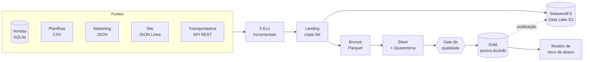
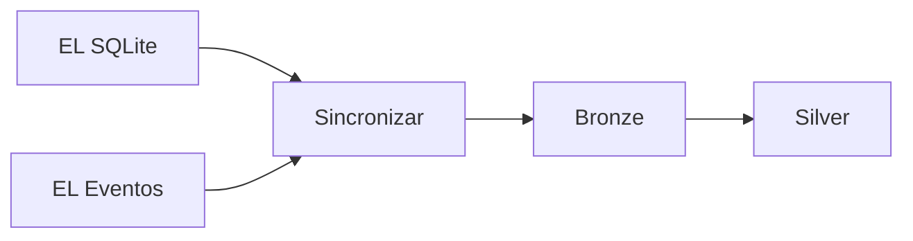
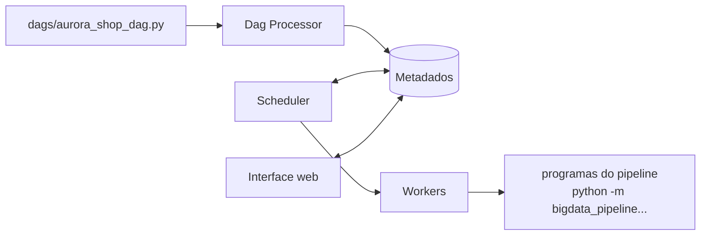
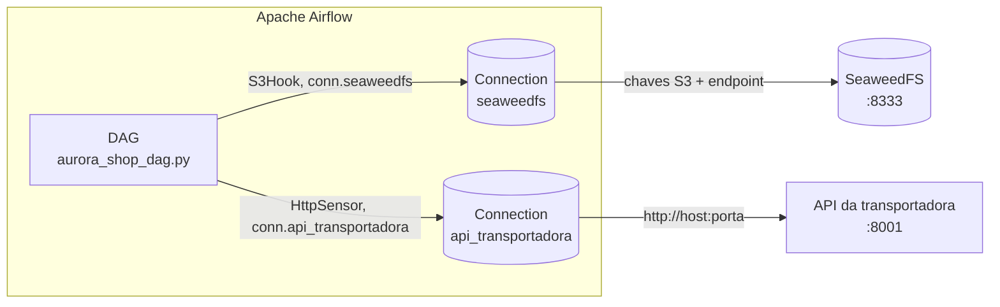
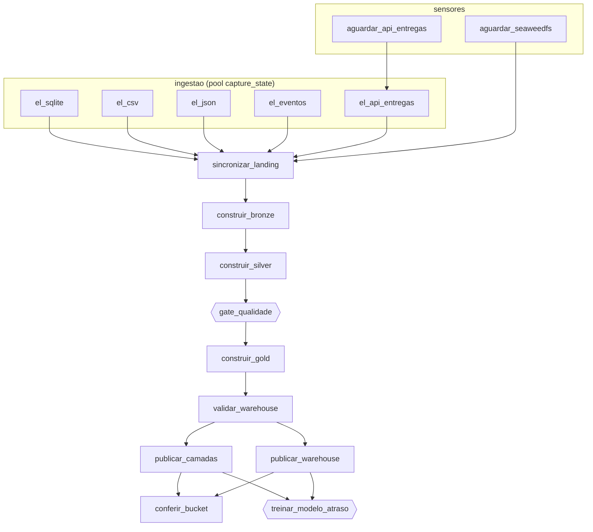

# Aula 7 — Orquestração do Pipeline Ponta a Ponta com Apache Airflow

## Conteúdo técnico e briefing do laboratório

**Tema:** orquestração de pipelines de dados, DAGs, integração com sistemas externos (Connections, Hooks, sensores e providers), gates de qualidade e observabilidade com o Apache Airflow  
**Duração:** 2 horas (cerca de 50 minutos de conteúdo e 70 minutos de laboratório)  
**Formato:** introdução conceitual guiada, seguida do laboratório `02_LABORATORIO_ORQUESTRACAO_E_PIPELINE_PONTA_A_PONTA.md`  
**Cenário:** a Aurora Shop já captura, guarda, trata e modela seus dados, mas cada etapa ainda depende de alguém executar um comando na ordem certa  
**Ambiente:** Windows, VS Code, Python, SeaweedFS, DuckDB e o Apache Airflow 3.1.8 no Ubuntu (WSL)

Este material é completo por si só: ele apresenta todas as peças da plataforma que o laboratório usa, inclusive as construídas em aulas anteriores.

---

## 1. O que você vai aprender

Ao final da aula, você deverá ser capaz de:

1. explicar a diferença entre **executar**, **agendar** e **orquestrar** um pipeline;
2. ler um **DAG** e explicar por que ele precisa ser acíclico;
3. explicar **por que** as empresas usam um orquestrador como o **Apache Airflow** e quais problemas ele resolve;
4. descrever como o Airflow se **conecta** a bancos, APIs e Data Lakes, usando **Connections**, **Hooks**, **sensores** e **providers**, sem senhas no código;
5. diferenciar três tipos de falha, **de serviço**, **de credencial** e **de dado**, e a reação certa para cada uma;
6. explicar o papel de um **gate de qualidade**: o ponto em que o pipeline para de propósito;
7. usar a interface do Airflow para acompanhar, retomar e auditar execuções.

> **Mensagem central:** cada peça da plataforma já funciona sozinha. Nesta aula elas passam a funcionar **juntas, todos os dias, na ordem certa, parando quando algo está errado e avisando quem precisa saber**.

---

## 2. Roteiro sugerido

| Bloco | Conteúdo | Seções | Tempo |
| --- | --- | --- | ---: |
| 1 | A plataforma até aqui e o problema da operação manual | 3 e 4 | 10 min |
| 2 | Orquestração e DAG | 5 | 10 min |
| 3 | Por que o Apache Airflow | 6 | 10 min |
| 4 | Como o Airflow se conecta aos sistemas | 7 | 10 min |
| 5 | O DAG da Aurora Shop: falhas, gate e modelo | 8 e 9 | 10 min |
| 6 | Briefing e laboratório | 10 | 70 min |

---

## 3. A plataforma até aqui: os ativos que vamos orquestrar

A **Aurora Shop** é uma loja online fictícia. Os dados dela nascem espalhados em bancos, planilhas, arquivos de eventos e na API de um parceiro. Ao longo do curso, construímos uma plataforma que leva esses dados até um Data Warehouse e um modelo de IA.



As tabelas abaixo apresentam cada ativo. A coluna **Origem** indica o tema em que ele foi construído: **Ingestão e Data Lake**, **Camadas e Warehouse** ou **Novo nesta aula**. Você não precisa ter feito as aulas anteriores: tudo já está pronto na pasta do projeto.

### 3.1 As fontes de dados

| Ativo | Onde fica | O que contém | Origem |
| --- | --- | --- | --- |
| **Sistema de vendas** | `data/source/sqlite/commerce.db` | Banco SQLite com 1.000 clientes, 30 fornecedores, 500 produtos, 10.000 pedidos, 29.891 itens e 10.000 pagamentos | Ingestão e Data Lake |
| **Planilhas de estoque** | `data/source/csv/` | Catálogo de produtos e 5 semanas de inventário, em CSV | Ingestão e Data Lake |
| **Campanhas de marketing** | `data/source/json/campaigns.json` | As campanhas e seus canais, em JSON | Ingestão e Data Lake |
| **Eventos do site** | `data/source/events/` | Visualizações, buscas, carrinhos e compras: um arquivo por dia, 30 dias, em JSON Lines (uma linha = um evento) | Ingestão e Data Lake |
| **API da transportadora** | `bigdata_pipeline/api/app.py`, em `http://127.0.0.1:8001` | Serviço FastAPI que entrega 10.000 entregas em páginas; tem uma rota `/health` para dizer se está no ar | Ingestão e Data Lake |
| **Gerador de dados** | `geradores/generate.py` e `geradores/simulate_live.py` | Cria as cinco fontes, com 2% de erros de propósito, e simula novas vendas | Ingestão e Data Lake |

Os dados têm **erros de propósito**: categorias escritas de formas diferentes, eventos duplicados, entregas de pedidos que não existem. São esses erros que a camada Silver e o gate precisam tratar.

### 3.2 Ingestão e Data Lake

| Ativo | Onde fica | O que faz | Origem |
| --- | --- | --- | --- |
| **ELs** (*Extract-Load*) | `bigdata_pipeline/el/` (`sqlite.py`, `csv.py`, `json.py`, `events.py`, `api.py`) | Cinco programas, um por fonte, que copiam para a Landing **somente o que é novo** | Ingestão e Data Lake |
| **Estado de captura** | `data/lake/control/capture_state.json` | O que cada EL já capturou: o último ID do SQLite (*watermark*), a última sequência da API e o SHA-256 de cada arquivo (*manifest*) | Ingestão e Data Lake |
| **Landing** | `data/lake/landing/` | Cópia fiel das fontes, sem nenhuma alteração. É a "prova" do que a fonte enviou | Ingestão e Data Lake |
| **SeaweedFS** | `tools/seaweedfs/weed.exe`; API S3 em `:8333`, navegador de arquivos (Filer) em `:8888` | Data Lake local compatível com o protocolo **S3** da Amazon; bucket `curso-bigdata`, chaves `admin` / `bigdata-secret` | Ingestão e Data Lake |
| **Sincronização** | `bigdata_pipeline/lake/sync.py` | Envia a Landing ao SeaweedFS, mas só os arquivos novos ou alterados (compara o SHA-256) | Ingestão e Data Lake |

Duas propriedades dessas peças são essenciais para orquestrar:

- **Incremental:** executar de novo não captura de novo o que já foi capturado;
- **Idempotente:** executar duas vezes produz o mesmo resultado que executar uma vez.

Um orquestrador vai **repetir** tarefas quando algo falhar. Sem essas duas propriedades, cada repetição duplicaria dados.

### 3.3 Camadas e Warehouse

| Ativo | Onde fica | O que faz | Origem |
| --- | --- | --- | --- |
| **Bronze** | `data/lake/bronze/` | A Landing convertida para **Parquet** (formato colunar), com colunas de linhagem: quando foi ingerido e de qual arquivo veio | Camadas e Warehouse |
| **Silver** | `data/lake/silver/` | Dados limpos, padronizados e sem duplicatas | Camadas e Warehouse |
| **Quarentena** | `data/lake/quarantine/` | Registros que violaram uma regra de qualidade, separados com o **motivo** (por exemplo, `pedido_inexistente`) | Camadas e Warehouse |
| **Relatório de qualidade** | `data/quality/report.json` | Quantos registros foram para a Silver e quantos para a quarentena, por fonte | Camadas e Warehouse |
| **Gold / Data Warehouse** | `data/warehouse/aurora.duckdb` | Banco **DuckDB** com dimensões, fatos (`fato_vendas`, `fato_eventos`, `fato_entregas`) e indicadores, como a receita aprovada por categoria | Camadas e Warehouse |
| **Validações** | `bigdata_pipeline/transform/validate.py` | Conferem a Gold: totais que fecham, grão correto, chaves duplicadas e chaves órfãs | Camadas e Warehouse |
| **Publicação** | `bigdata_pipeline/transform/publish.py` | Envia Bronze, Silver, Quarentena, Warehouse e relatórios ao SeaweedFS | Camadas e Warehouse |
| **Programa das camadas** | `bigdata_pipeline/transform/pipeline.py` | Constrói uma camada por vez: `--stage bronze`, `silver` ou `gold` | Camadas e Warehouse |

### 3.4 O que é novo nesta aula

| Ativo | Onde fica | O que faz |
| --- | --- | --- |
| **Gate de qualidade** | `bigdata_pipeline/transform/quality_gate.py` | Decide se a Silver pode virar Gold; se não puder, **bloqueia** o pipeline |
| **Modelo de risco de atraso** | `bigdata_pipeline/ml/risco_atraso.py` | Treina um modelo com a Gold, compara com uma referência e só o promove se for melhor |
| **DAG da Aurora Shop** | `dags/aurora_shop_dag.py` | O arquivo que descreve as 17 tarefas da plataforma e a ordem entre elas |
| **Apache Airflow 3.1.8** | Ubuntu 24.04 no WSL; interface em `http://localhost:8080` | Lê o DAG, executa as tarefas, guarda logs e histórico, segue a agenda |
| **Providers `amazon` e `http`** | instalados por `tools/airflow/instalar_airflow.sh` | Ensinam o Airflow a falar com o S3 (SeaweedFS) e com APIs HTTP |
| **Connections `seaweedfs` e `api_transportadora`** | cadastradas pelo aluno em **Admin → Connections** | Guardam endereço e credenciais dos dois sistemas externos |

### 3.5 O ambiente de trabalho

| Ativo | O que é |
| --- | --- |
| **VS Code** | Editor e terminais (PowerShell) onde todos os comandos são digitados |
| **Python 3.13 e `.venv`** | O Python do Windows, com as bibliotecas instaladas a partir da pasta `wheelhouse/`, sem internet |
| **WSL e Ubuntu 24.04** | Um Linux dentro do Windows, onde o Airflow roda (o Airflow não roda no Windows) |
| **Rede espelhada do WSL** | Configuração (`networkingMode=mirrored`) que permite ao Airflow, no Linux, alcançar o SeaweedFS e a API, no Windows |

---

## 4. O problema: uma plataforma que depende de alguém

Todas as peças da seção 3 funcionam. Mas, para atualizar o dashboard com os dados de hoje, alguém precisa executar, **na ordem certa**:

```text
 1. conferir se o SeaweedFS está ligado
 2. conferir se a API da transportadora responde
 3-7. executar os cinco ELs, um de cada vez
 8. sincronizar a Landing com o SeaweedFS
 9. construir a Bronze
10. construir a Silver
11. abrir o relatório de qualidade e decidir se está tudo bem
12. construir a Gold
13. validar o Warehouse
14. publicar no Data Lake
15. treinar o modelo
```

E repetir tudo amanhã, depois de amanhã e em todos os dias seguintes. O que pode dar errado:

| Situação | Consequência |
| --- | --- |
| Alguém esquece o EL de eventos | O funil do dashboard fica um dia atrasado, sem que ninguém perceba |
| Alguém executa a Gold antes da Silver | A Gold é recalculada com os dados de ontem |
| A API da transportadora está fora do ar às 6h | O EL falha e alguém precisa lembrar de executar de novo |
| A fonte de eventos muda de formato e 40% dos registros vão para a quarentena | A Gold é publicada com 60% dos dados, e a receita "cai" pela metade no dashboard |
| A senha do Data Lake foi trocada | Tudo falha, e a senha nova precisa ser trocada em vários scripts |
| O processo falha às 3h da manhã | Ninguém sabe que falhou, nem onde, nem por quê |
| A diretoria pergunta "esse número é de quando?" | Não existe registro de quando cada etapa rodou |

> **A pergunta da aula:** como fazer a plataforma rodar todos os dias, sozinha, na ordem certa, sem publicar dados ruins e avisando quando algo der errado?

---

## 5. Orquestração: o conceito

### 5.1 Executar, agendar e orquestrar

| | O que faz | Exemplo |
| --- | --- | --- |
| **Executar** | Roda um programa | `python -m bigdata_pipeline.transform.pipeline --stage silver` |
| **Agendar** | Roda um programa num horário | Agendador de Tarefas do Windows, `cron` no Linux |
| **Orquestrar** | Coordena **vários** programas: ordem, dependências, falhas, novas tentativas, credenciais, histórico e alertas | Apache Airflow, Dagster, Prefect |

Um agendador responde **quando** rodar. Um orquestrador também responde: **em que ordem**, o que fazer **se uma etapa falhar**, o que **não** rodar por causa disso, o que pode rodar **em paralelo**, **com quais credenciais**, **quem avisar** e **o que aconteceu** em cada execução passada.

Pense numa orquestra: cada músico (cada programa) sabe tocar a sua parte. O maestro não toca nenhum instrumento; ele decide **quando** cada um entra.

> O orquestrador não processa dados. Ele **coordena** quem processa. Os programas da seção 3 continuam iguais.

### 5.2 DAG: o mapa do pipeline

**DAG** (*Directed Acyclic Graph*, grafo direcionado acíclico) é o desenho das tarefas e da ordem entre elas:

| Palavra | Significado | No pipeline |
| --- | --- | --- |
| **Grafo** | Nós ligados por setas | Tarefas ligadas por dependências |
| **Direcionado** | Cada seta tem um sentido | "A Silver depende da Bronze", e não o contrário |
| **Acíclico** | Nenhum caminho volta ao início | Nenhuma tarefa depende de si mesma |



Por que **acíclico**? Se a Bronze dependesse da Silver e a Silver da Bronze, nenhuma das duas poderia começar. Por isso o Airflow recusa um DAG com ciclo antes de executar qualquer coisa.

Neste curso, usamos o termo em inglês, **DAG** (plural **DAGs**), como o mercado e a própria interface do Airflow, que mostra o menu **Dags**.

### 5.3 Vocabulário mínimo

| Termo | Significado | Na Aurora Shop |
| --- | --- | --- |
| **Tarefa** (*task*) | Uma etapa do DAG | `construir_silver` |
| **Upstream / downstream** | Tarefa que vem antes / depois | `construir_bronze` é *upstream* de `construir_silver` |
| **Execução** (*DAG run*) | Uma passagem completa pelo DAG | a execução das 6h de hoje |
| **Agenda** (*schedule*) | Quando o DAG roda sozinho | `0 6 * * *`: todo dia às 6h |
| **Parâmetro** (*param*) | Valor que pode mudar a cada execução | `max_quarantine_pct = 10` |
| **Nova tentativa** (*retry*) | Repetir uma tarefa que falhou | a API recebe 2 novas tentativas |
| **Sensor** | Tarefa que espera um serviço ficar disponível | `aguardar_api_entregas` |
| **Pool** | Limite de quantas tarefas de um grupo rodam ao mesmo tempo | os 5 ELs, um de cada vez |

### 5.4 Estados de uma tarefa

| Estado | Cor na tela | Significado |
| --- | --- | --- |
| `success` | verde | terminou bem |
| `running` | verde-claro | rodando agora |
| `queued` | cinza | esperando vaga |
| `up_for_retry` | amarelo | falhou, mas ainda tem novas tentativas |
| `failed` | vermelho | falhou e esgotou as tentativas |
| `upstream_failed` | laranja | **não rodou de propósito**, porque uma tarefa anterior falhou |

O estado mais importante da aula é `upstream_failed`. É o orquestrador dizendo: "Eu não construí a Gold **de propósito**, porque a etapa anterior falhou."

Como o Airflow sabe se uma tarefa deu certo? Pelo **código de saída** do programa: `0` é sucesso; qualquer outro número é falha. Um programa que imprime "ERRO", mas termina com 0, deu certo para o orquestrador.

---

## 6. Por que o Apache Airflow

### 6.1 O que é

O **Apache Airflow** é o orquestrador de código aberto mais usado em engenharia de dados. Foi criado no Airbnb em 2014 e hoje é mantido pela Apache Software Foundation. No Airflow, **o DAG é um arquivo Python**: o pipeline é escrito como código, revisado e versionado no Git como qualquer outro programa.

Componentes principais (Airflow 3):

| Componente | Papel |
| --- | --- |
| **Dag Processor** | Lê os arquivos Python da pasta `dags/` e registra os DAGs |
| **Scheduler** (Agendador) | Decide quais tarefas estão prontas e quando cada DAG deve rodar |
| **Executor / workers** | Executam as tarefas |
| **API server / interface web** | Mostra grafo, histórico e logs; permite disparar e retomar execuções |
| **Banco de metadados** | Guarda o estado de cada execução, de cada tarefa e as Connections |



### 6.2 As vantagens, na prática

| Sem orquestrador | Com o Airflow | Onde você vê no laboratório |
| --- | --- | --- |
| Alguém lembra a ordem dos 15 passos | A ordem está no DAG, e o Airflow a segue | o grafo (passo 8) |
| Alguém precisa estar acordado às 6h | A agenda dispara sozinha | `0 6 * * *` e a execução `scheduled__` (passo 11) |
| A API caiu e o EL falhou | O sensor espera e a tarefa é repetida | **Up For Retry** (passo 22) |
| O dado ruim chega ao dashboard | O gate bloqueia, e as tarefas seguintes não rodam | **Upstream Failed** (passo 18) |
| Depois de uma falha, tudo é refeito do começo | Retoma só o que falhou | **Clear only failed tasks** (passo 20) |
| A senha fica escrita em vários scripts | A senha fica em uma Connection, criptografada | **Admin → Connections** (passo 10) |
| "Esse número é de quando?" | Cada execução, tarefa e log fica registrado | a grade e os logs (passo 30) |
| Dois ELs gravam o mesmo arquivo ao mesmo tempo | O pool limita a uma tarefa por vez | **Admin → Pools** (item 8.5) |

### 6.3 Por que o Airflow, e não outra ferramenta

| Motivo | Explicação |
| --- | --- |
| **Padrão de mercado** | É o orquestrador mais pedido em vagas de engenharia de dados |
| **Código aberto** | Gratuito, sem dependência de um fornecedor |
| **DAG em Python** | A mesma linguagem do resto da plataforma |
| **Interface visual** | Grafo, grade de execuções e logs, sem precisar ler arquivos |
| **Providers** | Pacotes prontos para centenas de sistemas: S3, PostgreSQL, Snowflake, BigQuery, Databricks, Slack... |
| **Versão gerenciada nas nuvens** | Amazon MWAA, Google Cloud Composer e Astronomer rodam o mesmo DAG, sem administrar servidores |

Outras opções e quando aparecem:

| Ferramenta | Tipo | Característica |
| --- | --- | --- |
| **Dagster** | Código aberto | Orientado a *assets* (tabelas, arquivos), e não a tarefas |
| **Prefect** | Código aberto | Fluxos em Python puro, com pouca configuração |
| **Azure Data Factory** | Serviço de nuvem | Orquestração visual no Azure |
| **AWS Step Functions** | Serviço de nuvem | Máquinas de estado para serviços AWS |

Os conceitos desta aula (DAG, dependências, novas tentativas, sensores, conexões, gates, observabilidade) valem para todas.

### 6.4 O que o Airflow não é

Ser honesto sobre os limites ajuda a usar bem a ferramenta:

- **não processa dados:** quem transforma é o Python, o DuckDB, o Spark; o Airflow só coordena;
- **não é para tempo real:** ele trabalha com execuções em lote (*batch*), de minutos a dias; para fluxos contínuos, usam-se ferramentas como Kafka;
- **não roda no Windows:** precisa de Linux ou macOS. Por isso, no laboratório, ele roda no Ubuntu do WSL;
- **exige que as tarefas sejam idempotentes:** se uma tarefa duplicar dados ao ser repetida, as novas tentativas viram um problema.

---

## 7. Como o Airflow se conecta aos sistemas

Orquestrar é coordenar programas que falam com **outros sistemas**. O Airflow organiza essa integração em quatro peças:

| Peça | O que é | No laboratório |
| --- | --- | --- |
| **Provider** | Pacote que ensina o Airflow a falar com uma tecnologia | `apache-airflow-providers-amazon`, `apache-airflow-providers-http` |
| **Connection** | Cadastro com endereço, usuário, senha e extras de um sistema, identificado por um nome (*conn id*) | `seaweedfs` (tipo AWS), `api_transportadora` (tipo HTTP) |
| **Hook** | Classe Python que lê uma Connection e entrega um cliente pronto | `S3Hook("seaweedfs")` |
| **Operador / sensor** | Tarefa pronta que usa um Hook por dentro | `HttpSensor(http_conn_id="api_transportadora")` |



### 7.1 Três jeitos de usar uma Connection

| Jeito | Exemplo no DAG | Quando usar |
| --- | --- | --- |
| Sensor ou operador pronto | `HttpSensor(http_conn_id="api_transportadora", endpoint="health")` | quando o provider já tem a tarefa necessária |
| Hook dentro de uma função Python | `S3Hook("seaweedfs").get_conn().head_bucket(...)` | lógica própria, com o cliente já configurado |
| Template num comando | `"{{ conn.seaweedfs.login }}"` nas variáveis de ambiente | programas que já existem e leem variáveis de ambiente |

O terceiro jeito é o que permite orquestrar os programas da seção 3 **sem alterá-los**: o `lake/sync.py` continua lendo `AWS_ACCESS_KEY_ID` e `S3_ENDPOINT_URL` do ambiente; quem preenche esses valores é o Airflow, a partir da Connection, na hora de executar.

### 7.2 Por que as credenciais não ficam no código

| Credencial no código | Credencial na Connection |
| --- | --- |
| a senha vai para o Git e fica no histórico para sempre | a senha fica no banco do Airflow, criptografada |
| trocar a senha exige alterar e publicar o código | trocar a senha é editar a Connection |
| o mesmo código não serve para teste e produção | cada ambiente tem suas Connections, com o mesmo nome |
| a senha aparece em logs e telas | o Airflow mostra `***` nos logs e nas telas |

Em produção, as Connections costumam vir de um **cofre de senhas** (*secrets backend*: AWS Secrets Manager, HashiCorp Vault, Azure Key Vault). O DAG não muda, porque só conhece o nome da conexão.

### 7.3 Três tipos de falha, três reações

| Tipo | Exemplo | Repetir resolve? | Reação no DAG | Quem corrige |
| --- | --- | --- | --- | --- |
| **De serviço** | a API está fora do ar (`Connection refused`) | sim, quando o serviço voltar | sensor espera; novas tentativas | quem opera o serviço |
| **De credencial** | a senha do Data Lake está errada (`403 Forbidden`) | não | o sensor falha **na hora**, com mensagem clara | quem administra a Connection |
| **De dado** | 40% dos eventos na quarentena | não | o gate **bloqueia**; nada depois dele roda | a equipe dona da fonte |

As três aparecem no laboratório: a API derrubada (passo 22), a senha trocada (passo 24) e o gate com um limite mais rigoroso (passo 18).

---

## 8. O DAG da Aurora Shop

### 8.1 O grafo



São **17 tarefas** em sete grupos:

| Grupo | Tarefas | Tipo no Airflow | Usa Connection |
| --- | --- | --- | --- |
| `sensores` | `aguardar_seaweedfs`, `aguardar_api_entregas` | `@task.sensor` com `S3Hook`; `HttpSensor` | `seaweedfs`; `api_transportadora` |
| `ingestao` | os 5 ELs | `BashOperator` | só `el_api_entregas` (`api_transportadora`) |
| `lake` | `sincronizar_landing` | `BashOperator` | `seaweedfs` |
| `transformacao` | `construir_bronze`, `construir_silver`, `gate_qualidade` | `BashOperator` | — |
| `warehouse` | `construir_gold`, `validar_warehouse` | `BashOperator` | — |
| `publicacao` | `publicar_camadas`, `publicar_warehouse`, `conferir_bucket` | `BashOperator`; `@task` com `S3Hook` | `seaweedfs` |
| `produtos` | `treinar_modelo_atraso` | `BashOperator` | — |

Quase todas as tarefas são **programas que já existiam**. O `BashOperator` executa cada um como um comando de terminal comum, por exemplo `python -m bigdata_pipeline.el.sqlite`.

### 8.2 Decisões de desenho

| Pergunta | Resposta |
| --- | --- |
| Por que os ELs não esperam o SeaweedFS? | Eles gravam na Landing local. Só a sincronização precisa do Data Lake |
| Por que os ELs rodam um de cada vez, se não dependem um do outro? | Todos regravam o mesmo `capture_state.json`. Em paralelo, um apagaria o que o outro gravou (**condição de corrida**). O pool `capture_state` tem uma vaga |
| Por que sincronizar antes da Bronze? | Para **não transformar o que ainda não foi guardado**: se algo falhar depois, a Landing já está no Data Lake |
| Por que o gate fica entre a Silver e a Gold? | A Silver é onde a qualidade é medida; a Gold é o que o negócio consome |
| Por que uma execução por vez (`max_active_runs=1`)? | O `aurora.duckdb` aceita um único programa gravando |
| Por que o gate não tem novas tentativas? | Repetir não corrige um dado ruim |

---

## 9. Os dois gates: qualidade e modelo

### 9.1 Gate de qualidade

Um **gate** (portão) é uma tarefa que não transforma dados: ela **decide** se o pipeline continua.

| Regra bloqueante | Verificação |
| --- | --- |
| `percentual_quarentena` | em cada fonte, a quarentena não pode passar de `max_quarantine_pct` (padrão: 10%) |
| `reconciliacao` | Bronze = Silver + Quarentena: nenhum registro pode sumir em silêncio |
| `volume_minimo` | clientes, produtos, pedidos, itens, pagamentos e eventos não podem estar vazios |

Quando o gate bloqueia, a Gold **não é alterada**: o dashboard continua com a última versão aprovada, nada é publicado e um alerta é gravado em `data/orchestration/alerts.jsonl`. Entre "dado de ontem correto" e "dado de hoje errado", a plataforma fica com o primeiro, e avisa.

O gate também gera **alertas**, que não bloqueiam, mas pedem investigação. Exemplo: 1.397 pedidos cancelados cuja entrega aparece como concluída, gravados em `data/quality/alerts/` para as áreas Comercial e de Logística.

> O limite de 10% não é uma verdade técnica: é uma decisão tomada com a área de negócio. Por isso é um **parâmetro** do DAG, que pode mudar a cada execução.

### 9.2 Gate do modelo

A última tarefa treina um modelo que estima o **risco de atraso** de uma entrega, com a Gold validada:

| Item | Decisão |
| --- | --- |
| Algoritmo | Regressão logística (scikit-learn) |
| Divisão | **Temporal**: treina com as entregas mais antigas e avalia com as mais recentes |
| Referência | Um **baseline** que sempre prevê a taxa média de atraso |
| Regra de promoção | AUC ≥ 0,60 **e** pelo menos 0,02 acima do baseline |

No laboratório, o modelo é **rejeitado** (AUC 0,4864), e esse é o resultado correto: o gerador sorteia o atraso ao acaso, então não existe padrão para aprender.

> O pipeline não existe para produzir um modelo. Existe para produzir **evidência** sobre o modelo. Sem o baseline e o gate, um modelo equivalente a jogar uma moeda poderia ter sido publicado.

---

## 10. Briefing do laboratório

### 10.1 O que você vai fazer

Você **não vai programar**. Vai instalar o Airflow, **ler** os arquivos que configuram a integração, **cadastrar** as conexões e operar o pipeline pela interface web, provocando falhas de propósito para ver como a plataforma reage.

| Fase | O que acontece | Passos | Tempo aproximado |
| --- | --- | --- | ---: |
| 0 | Preparar o ambiente: WSL, Python, dados, Airflow e serviços | 1 a 6 | 25 min |
| 1 | Conhecer a tela do Airflow, ler o DAG e cadastrar as Connections | 7 a 10 | 15 min |
| 2 | Primeira execução: 17 tarefas, um clique | 11 a 15 | 8 min |
| 3 | Reexecutar sem mudar nada: idempotência | 16 e 17 | 4 min |
| 4 | O gate de qualidade bloqueia | 18 a 21 | 6 min |
| 5 | Falhas de integração: API fora do ar e senha errada | 22 a 24 | 8 min |
| 6 | Um lote novo de vendas atravessa a plataforma | 25 a 27 | 3 min |
| 7 | Agenda e histórico | 28 a 32 | 3 min |

> A instalação do WSL e do Airflow (Fase 0) é a parte mais longa e precisa de internet. Se o WSL, o `.venv`, os dados e o Airflow já estiverem prontos no computador (passos 2 a 4), comece no passo 5.

### 10.2 Os quatro terminais

| Terminal | Para quê | Fica aberto? |
| --- | --- | --- |
| **1** | comandos avulsos: preparar dados, consultar a receita, simular vendas | sim |
| **2** | SeaweedFS (Data Lake) | sim, a aula inteira |
| **3** | API da transportadora | sim; você vai derrubá-la e religá-la no passo 22 |
| **4** | Apache Airflow | sim, a aula inteira |

### 10.3 Cuidados que evitam os erros mais comuns

| Cuidado | Por quê |
| --- | --- |
| Em **todo terminal novo**, confira se o prompt termina em `AULA 7 - Orquestração e Pipeline Ponta a Ponta>` | Se o VS Code estiver aberto na pasta do curso, o terminal começa fora da aula, e os comandos falham com `.venv\Scripts\python.exe não é reconhecido` |
| No passo 10, **digite** os valores das Connections em vez de copiá-los da tabela | A cópia de uma célula leva um TAB invisível, e a senha vira outra |
| Na Connection HTTP, o `http` vai em **Schema**, e não em **Login** | Senão, o EL da API recebe um endereço inválido |
| Não abra o `aurora.duckdb` em outro programa durante a aula | O DuckDB aceita um único programa gravando, e a Gold falharia |
| **Admin → Config** mostra `403 Forbidden` | É o esperado: o Airflow esconde a configuração por segurança |

### 10.4 O que observar

| Pergunta que você deve saber responder ao final | Onde a resposta aparece |
| --- | --- |
| Onde está a senha do Data Lake? Por que não está no código? | Admin → Connections; o DAG só tem `{{ conn.seaweedfs.password }}` |
| Por que o sensor da API esperou, e o do Data Lake falhou na hora? | logs dos passos 22 e 24 |
| Por que a Gold não mudou quando o gate bloqueou? | estado **Upstream Failed** e a receita igual (passo 19) |
| O que mudou na segunda execução, se os dados eram os mesmos? | logs dos ELs com zero registros (passo 17) |
| Por que o modelo foi rejeitado, e por que isso é bom? | log de `treinar_modelo_atraso` (passo 14) |

### 10.5 Evidências de entrega

As evidências pedidas estão no final do roteiro do laboratório: prints do grafo, das Connections, da primeira execução, do gate bloqueando, das duas falhas de integração e do histórico, mais as respostas às perguntas de discussão.

---

## 11. Dicionário técnico

| Termo | Definição curta |
| --- | --- |
| **Orquestração** | Coordenação de várias tarefas: ordem, dependências, falhas, credenciais, histórico e alertas |
| **DAG** | Grafo direcionado acíclico: as tarefas e a ordem entre elas |
| **Tarefa** (*task*) | Uma etapa do DAG |
| **Upstream / downstream** | Tarefa que vem antes / depois na dependência |
| **DAG run** | Uma execução completa do DAG |
| **Expressão cron** | Formato de cinco campos para uma agenda; `0 6 * * *` = todo dia às 6h |
| **Código de saída** | Número devolvido por um programa; 0 indica sucesso |
| **Retry** | Nova tentativa após uma falha |
| **Sensor** | Tarefa que espera uma condição externa ficar verdadeira |
| **Poke** | Cada verificação feita por um sensor |
| **upstream_failed** | Tarefa que não rodou porque uma anterior falhou |
| **Clear** | Reexecutar tarefas de uma execução, por exemplo só as que falharam |
| **Pool** | Grupo de tarefas com número limitado de vagas simultâneas |
| **Condição de corrida** | Erro cujo resultado depende de qual processo termina primeiro |
| **Idempotência** | Executar de novo produz o mesmo resultado |
| **Incremental** | Capturar somente o que é novo desde a última execução |
| **Params** | Valores configuráveis de uma execução |
| **Provider** | Pacote que acrescenta ao Airflow a integração com uma tecnologia |
| **Connection** | Cadastro de endereço e credenciais de um sistema, usado pelo nome (*conn id*) |
| **Hook** | Classe que lê uma Connection e devolve um cliente pronto |
| **Template** | Texto com `{{ }}` que o Airflow preenche na hora de executar, como `{{ conn.seaweedfs.login }}` |
| **XCom** | Valor devolvido por uma tarefa e guardado pelo Airflow |
| **Secrets backend** | Cofre externo de senhas de onde o Airflow lê as Connections em produção |
| **BashOperator** | Operador que executa um comando de terminal |
| **TaskGroup** | Agrupamento visual de tarefas |
| **Gate** | Tarefa que decide se o pipeline continua |
| **Baseline** | Referência mínima que um modelo precisa superar |
| **Observabilidade** | Capacidade de entender o que aconteceu pelo que o sistema registrou |

---

## 12. Notas para o professor

### 12.1 Plano B

O projeto tem um orquestrador local simples, `bigdata_pipeline/orchestration/runner.py`, que roda no Windows, sem internet (`python -m bigdata_pipeline.orchestration.runner`, com `--param`, `--resume last` e `--history`). Ele não aparece no roteiro dos alunos. Serve para ensaiar e para seguir com a turma se o WSL ou o Airflow não funcionarem em algum computador.

O runner lê a lista de tarefas de `bigdata_pipeline/orchestration/dag.py`, que **não** é usada pelo Airflow: uma mudança de dependência precisa ser feita nos dois arquivos. O runner não tem Connections (usa as credenciais fixas do laboratório) nem a tarefa `conferir_bucket`.

### 12.2 Validação

O DAG foi validado em 29/10/2026 no Airflow 3.1.8 (providers amazon 9.22.0 e http 6.0.0), no Ubuntu 24.04 (WSL) com rede espelhada, partindo do bucket e do lake vazios:

- as 17 tarefas terminaram com sucesso, com os números do roteiro (44 objetos na Landing, 164.642 linhas na Bronze, receita aprovada de R$ 77.740.683,02, AUC 0,4864);
- com a API desligada, o `HttpSensor` ficou em *Up For Retry* e o pipeline seguiu quando a API voltou;
- com a senha da Connection `seaweedfs` errada, o sensor falhou na hora; com a Connection corrigida, *Clear only failed tasks* concluiu a execução sem repetir os ELs;
- com o SeaweedFS desligado, o sensor fez novos pokes e desistiu aos 60 segundos.

As bibliotecas do Airflow no WSL precisam ter as **mesmas versões** do `.venv` do Windows (`duckdb==1.5.6`, `pandas==2.3.3`, `scikit-learn==1.9.1`). Com o DuckDB 2.0, o `aurora.duckdb` gravado pelo Airflow não abre no Windows (`version number 69`). O instalador já fixa essas versões.

### 12.3 Limitações do laboratório

| Neste laboratório | Em produção |
| --- | --- |
| Airflow `standalone`: tudo em um computador | Scheduler e workers distribuídos, ou serviço gerenciado (MWAA, Cloud Composer) |
| Metadados do Airflow em SQLite | Banco de metadados em PostgreSQL |
| Connections cadastradas na tela | Connections vindas de um cofre de senhas (*secrets backend*) |
| Alertas gravados em arquivo | E-mail, Slack, Teams, PagerDuty |
| A agenda só funciona com o terminal do Airflow aberto | Scheduler sempre ativo, com alta disponibilidade |
| Gate depois de a Silver já ter sido gravada | Write-Audit-Publish, com Iceberg ou Delta Lake |
| Silver e Gold recriadas a cada execução | Processamento incremental por partição |

### 12.4 Checklist antes da aula

- [ ] Em uma cópia limpa da pasta (sem `.venv` e sem `data/`), executar os passos 1 a 3 do laboratório e confirmar `Geração concluída.`
- [ ] Confirmar que o bucket `curso-bigdata` da cópia distribuída aos alunos está vazio (Apêndice A.2 do laboratório).
- [ ] Confirmar que o `wheelhouse` contém `duckdb`, `scikit-learn` e `pandas` para Windows e Python 3.13.
- [ ] Confirmar nos computadores: Windows 11 22H2 ou mais recente, virtualização habilitada na BIOS, permissão de administrador para `wsl --install` e internet liberada para `pypi.org` e `raw.githubusercontent.com`.
- [ ] Em um computador do laboratório, executar o passo 2 (WSL e rede espelhada) e o instalador do passo 4, e conferir `INSTALAÇÃO CONCLUÍDA`.
- [ ] Conferir em **Admin → Providers** que `amazon` e `http` estão instalados, e em **Admin → Connections** que a lista está **vazia**.
- [ ] Ensaiar o roteiro inteiro, do passo 7 ao 32, conferindo os números das Fases 2, 3 e 6 e os dois experimentos da Fase 5.
- [ ] Ter o plano B (`runner.py`) pronto.

---

## 13. Encerramento

Ao final desta aula, a plataforma da Aurora Shop:

- roda como **um único DAG de 17 tarefas**, todos os dias às 6h, sem ninguém apertar botões;
- fala com o Data Lake e com a API por **Connections**, sem nenhuma senha no código;
- **espera** quando um serviço está fora do ar, **falha na hora** quando a credencial está errada e **bloqueia** quando o dado está ruim;
- **retoma** a partir da falha, sem refazer o que já deu certo;
- **registra** cada execução, para responder "esse número é de quando?".

```text
Aurora Shop Data Platform
├── ingestão de cinco fontes, incremental e idempotente
├── Data Lake local (SeaweedFS, protocolo S3)
├── camadas Bronze, Silver e Gold
├── qualidade: quarentena, validações e gate
├── Data Warehouse analítico (DuckDB)
├── modelo de IA com gate de promoção
└── pipeline orquestrado, integrado e observável (Apache Airflow)
```

> "Uma plataforma de dados não é um conjunto de scripts que funcionam. É um conjunto de scripts que **funcionam juntos, todos os dias, e avisam quando não funcionam**."
