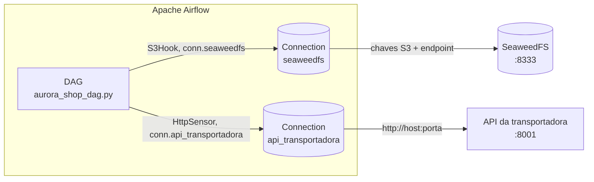
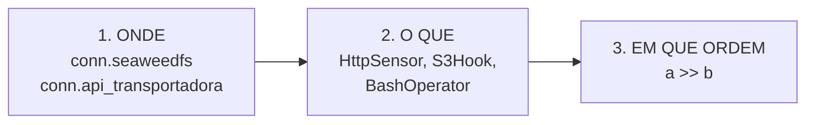

# Aula 7 — Laboratório de Orquestração do Pipeline Ponta a Ponta

## Objetivo

Fazer a plataforma de dados da Aurora Shop, uma loja online fictícia, funcionar **como um único pipeline**: executado na ordem certa, protegido por um gate de qualidade, capaz de se recuperar de falhas e com cada execução registrada.

Este roteiro é completo por si só: você não precisa ter feito outros laboratórios. Tudo o que o pipeline usa já está na pasta do projeto. A única instalação é a do **Apache Airflow**, na Fase 0, que precisa de internet.

## A plataforma em uma página

A Aurora Shop tem cinco fontes de dados:

| Fonte | Arquivo | Conteúdo |
| --- | --- | --- |
| Sistema de vendas | `data/source/sqlite/commerce.db` | clientes, fornecedores, produtos, pedidos, itens e pagamentos (SQLite) |
| Planilhas | `data/source/csv/` | catálogo e estoque semanal (CSV) |
| Marketing | `data/source/json/campaigns.json` | campanhas (JSON) |
| Site | `data/source/events/` | eventos de navegação, um arquivo por dia (JSON Lines) |
| Transportadora | API em `http://127.0.0.1:8001` | entregas, entregues em páginas |

Os dados percorrem estas camadas:

```text
Fontes ─▶ ELs ─▶ Landing ─▶ SeaweedFS ─▶ Bronze ─▶ Silver + Quarentena ─▶ Gold (DuckDB)
```

| Camada | O que é |
| --- | --- |
| **EL** (*Extract-Load*) | Programa que copia da fonte para a Landing somente o que é novo (incremental) |
| **Landing** | Cópia fiel das fontes, em `data/lake/landing/` |
| **SeaweedFS** | Data Lake local compatível com S3, bucket `curso-bigdata` |
| **Bronze** | Landing convertida para Parquet, com colunas de linhagem (`_ingested_at`, arquivo de origem) |
| **Silver** | Dados limpos e padronizados; o que viola uma regra de qualidade vai para a **Quarentena** |
| **Gold** | Data Warehouse `data/warehouse/aurora.duckdb`: dimensões, fatos e indicadores |

Cada camada já tem seu programa pronto em `bigdata_pipeline/`. O trabalho desta aula é **orquestrar** esses programas e **conectar** o orquestrador aos sistemas de que eles dependem.

## Como o Airflow se conecta aos sistemas

Um orquestrador precisa falar com bancos, APIs e Data Lakes. No Airflow, isso é feito com três peças:

| Peça | O que é | Nesta aula |
| --- | --- | --- |
| **Connection** | Cadastro com endereço, usuário e senha de um sistema, guardado no Airflow com um nome (*conn id*) | `seaweedfs` (Data Lake S3) e `api_transportadora` (API HTTP) |
| **Hook** | Objeto Python que lê uma Connection e entrega um cliente pronto para usar | `S3Hook("seaweedfs")` |
| **Sensor** | Tarefa que espera um sistema ficar disponível antes de seguir | `HttpSensor` na API e um sensor com `S3Hook` no SeaweedFS |

Essas peças vêm em **providers**, pacotes que ensinam o Airflow a falar com cada tecnologia (`apache-airflow-providers-amazon`, `apache-airflow-providers-http`...).



O DAG **não tem nenhuma senha ou endereço escrito no código**: ele só conhece os nomes das conexões. Quem sabe onde o SeaweedFS está e qual é a senha é o Airflow. Se o servidor mudar, muda-se a Connection, e o código continua o mesmo.

Ao final deste laboratório, o aluno terá:

```text
um DAG de 17 tarefas
├── 2 sensores               HttpSensor (API) e S3Hook (SeaweedFS)
├── 5 ELs                    capturam as fontes, um por vez (pool)
├── sincronização            envia a Landing ao SeaweedFS
├── Bronze e Silver          padronização e regras de qualidade
├── gate de qualidade        regra bloqueante + alertas
├── Gold e validações        Data Warehouse no DuckDB
├── 2 publicações            em paralelo
├── conferência do bucket    S3Hook conta os objetos do Data Lake
└── modelo de risco          dataset, treino e gate do modelo

2 Connections                cadastradas por você no Airflow

executado pelo Apache Airflow
├── interface web            grafo, grade de execuções e logs
├── agenda                   todo dia às 6h
└── retomada                 reexecuta só o que falhou

data/orchestration/
└── alerts.jsonl             falhas registradas pelo Airflow
```

O laboratório está dividido em oito fases:

```text
Fase 0 — Preparar o ambiente (inclui instalar o Airflow)
Fase 1 — Conhecer o Airflow, o DAG e as Connections
Fase 2 — Primeira execução orquestrada
Fase 3 — Reexecutar: idempotência ponta a ponta
Fase 4 — O gate de qualidade bloqueia
Fase 5 — Falhas de integração: serviço fora do ar e senha errada
Fase 6 — Um lote novo atravessa a plataforma
Fase 7 — Agendamento e histórico
```

> Nesta aula você não programa nem executa os ELs, a Bronze, a Silver ou a Gold manualmente. Você **lê os arquivos que configuram a integração**, cadastra as conexões e executa **o DAG no Airflow**, que executa todos esses passos.

---

# Fase 0 — Preparar o ambiente

## 1. Abrir o projeto

No VS Code, use `File → Open Folder` e abra a pasta:

```text
AULA 7 - Orquestração e Pipeline Ponta a Ponta
```

Todos os comandos deste roteiro são digitados no terminal do VS Code (PowerShell), **dentro dessa pasta**. Para abrir um terminal: `Terminal → New Terminal`. Esse é o **terminal 1**. O caminho mostrado no terminal deve terminar em `AULA 7 - Orquestração e Pipeline Ponta a Ponta`:

```text
PS C:\...\AULA 7 - Orquestração e Pipeline Ponta a Ponta>
```

Se terminar em outra pasta (por exemplo, se o VS Code estiver aberto na pasta do curso inteiro), entre na pasta da aula antes de qualquer comando:

```powershell
cd "AULA 7 - Orquestração e Pipeline Ponta a Ponta"
```

> **As aspas são obrigatórias**, porque o nome da pasta tem espaços. Sem elas, o PowerShell responde `Não foi possível encontrar um parâmetro posicional que aceite o argumento '7'`. Atalho: digite `cd AULA` e aperte `Tab`; o PowerShell completa o nome e coloca as aspas.

> **Vale para todo terminal novo:** confira o caminho e, se preciso, use o `cd` acima.

> Copie cada comando inteiro, cole no terminal e tecle `Enter`.

A pasta já contém tudo o que a aula usa:

| Pasta | Conteúdo |
| --- | --- |
| `bigdata_pipeline/` | os programas de cada camada e o orquestrador |
| `geradores/` | o gerador das fontes de dados da Aurora Shop |
| `tools/seaweedfs/` | o Data Lake local (SeaweedFS) |
| `wheelhouse/` | as bibliotecas Python, para instalar sem internet |

O Python 3.13 já está instalado no computador do laboratório. Confira no terminal:

```powershell
py --version
```

```text
Python 3.13.x
```

## 2. Instalar o WSL e o Ubuntu

Nesta aula você vai usar o **Apache Airflow**, o orquestrador mais usado no mercado. Ele roda em Linux. No Windows, o Linux vem do **WSL** (*Windows Subsystem for Linux*).

Este passo precisa de **internet** e de permissão de **administrador**, e pode pedir para reiniciar o computador. Por isso ele vem antes de todo o resto.

Este passo tem quatro partes. Em cada uma, o roteiro diz **onde** digitar e **qual prompt** você deve ver. O prompt é o texto que aparece antes do cursor e mostra em qual terminal você está:

| Prompt | Onde você está |
| --- | --- |
| `PS C:\...\AULA 7 - Orquestração e Pipeline Ponta a Ponta>` | **terminal 1** do VS Code (PowerShell). É onde quase tudo é feito. |
| `PS C:\WINDOWS\system32>` | PowerShell **de administrador**, numa janela separada. Usado só na parte 2.2. |
| `usuario@computador:~$` | **dentro do Ubuntu** (Linux). Usado só na parte 2.3. |

### 2.1 Conferir se o Ubuntu já está instalado

**Onde:** terminal 1 (`PS C:\...\AULA 7 - Orquestração e Pipeline Ponta a Ponta>`).

```powershell
wsl -l -v
```

Exemplo de resposta com o Ubuntu já instalado:

```text
  NAME            STATE           VERSION
* Ubuntu-24.04    Stopped         2
```

Se a lista mostrar `Ubuntu-24.04`, o Ubuntu já está instalado: **pule para a parte 2.4**. Tanto faz se o estado (`STATE`) for `Stopped` (desligado) ou `Running` (ligado). Outras linhas, como `Ubuntu` ou `docker-desktop`, podem aparecer e não atrapalham. Caso contrário, faça as partes 2.2 e 2.3.

### 2.2 Instalar o Ubuntu

**Onde:** PowerShell **de administrador**, numa janela fora do VS Code. Para abrir: menu Iniciar → digite `PowerShell` → botão direito → *Executar como administrador*. O prompt é `PS C:\WINDOWS\system32>`.

```powershell
wsl --install -d Ubuntu-24.04
```

Quando terminar, **feche essa janela de administrador**. Ela não é mais usada.

> Se aparecer `Wsl/InstallDistro/ERROR_ALREADY_EXISTS`, o Ubuntu-24.04 **já estava instalado**: nada foi alterado. Feche a janela e vá para a parte 2.4.

Se o Windows pedir, reinicie o computador. Depois, abra o VS Code de novo, abra um terminal e confira se o prompt termina em `AULA 7 - Orquestração e Pipeline Ponta a Ponta>` (se não, use o `cd` do passo 1).

### 2.3 Criar o usuário do Linux

No primeiro uso, o Ubuntu pede um **nome de usuário** e uma **senha** para o Linux. Às vezes uma janela do Ubuntu abre sozinha depois da instalação pedindo isso; se abriu, crie o usuário nela e feche-a.

Se nenhuma janela abriu, **onde:** terminal 1 (`PS C:\...\AULA 7 - Orquestração e Pipeline Ponta a Ponta>`):

```powershell
wsl -d Ubuntu-24.04
```

O Ubuntu pergunta:

```text
Enter new UNIX username:
```

Digite um nome curto, sem espaços nem acentos (por exemplo, `aluno`), e tecle `Enter`. Depois ele pede a senha duas vezes (`New password:` e `Retype new password:`). **A senha não aparece enquanto você digita**: é normal. Digite e tecle `Enter`. **Anote a senha**: ela pode ser pedida no passo 4.

> Se o Ubuntu **não** perguntar o nome de usuário e já mostrar um prompt como `seunome@computador:...$`, o usuário já existe. Não há nada para criar: apenas saia, com o `exit` abaixo.

Ao terminar, o prompt muda para o do Linux, parecido com `aluno@computador:~$` (pode aparecer um caminho no lugar do `~`). Não digite outros comandos aqui. Saia do Ubuntu:

```bash
exit
```

O prompt volta a ser `PS C:\...\AULA 7 - Orquestração e Pipeline Ponta a Ponta>`. **Não siga em frente enquanto o prompt não voltar**: os comandos do roteiro são do PowerShell e não funcionam dentro do Ubuntu.

> O Windows pode ter mais de um Ubuntu instalado. Use sempre `-d Ubuntu-24.04`, com a versão, como nos comandos deste roteiro.

### 2.4 Ativar a rede espelhada

O Airflow vai rodar no Ubuntu, mas o SeaweedFS e a API rodam no Windows. Com a rede espelhada (*mirrored*), o Ubuntu enxerga os serviços do Windows em `127.0.0.1`.

**Onde:** terminal 1 (`PS C:\...\AULA 7 - Orquestração e Pipeline Ponta a Ponta>`).

```powershell
Set-Content -Path "$env:USERPROFILE\.wslconfig" -Value "[wsl2]`nnetworkingMode=mirrored"
wsl --shutdown
```

Confira, no mesmo terminal:

```powershell
wsl -d Ubuntu-24.04 -- wslinfo --networking-mode
```

```text
mirrored
```

Esse comando roda no Ubuntu e volta sozinho: o prompt continua `PS C:\...\AULA 7 - Orquestração e Pipeline Ponta a Ponta>`. É nesse mesmo terminal que você segue para o passo 3.

> A rede espelhada exige Windows 11 (versão 22H2 ou mais recente). O comando substitui um `.wslconfig` que já exista. Se a resposta não for `mirrored`, avise o professor.

## 3. Preparar o ambiente e os dados

Continue no **terminal 1** do VS Code, no PowerShell. Antes de seguir, confira o prompt:

| O prompt mostra | O que fazer |
| --- | --- |
| `PS C:\...\AULA 7 - Orquestração e Pipeline Ponta a Ponta>` | Está certo. Siga em frente. |
| `usuario@computador:~$` (você ficou dentro do Ubuntu) | Digite `exit` para voltar ao PowerShell. |
| `PS C:\WINDOWS\system32>` (é o PowerShell de administrador) | Feche essa janela e volte ao terminal 1 do VS Code. |
| `PS` com outra pasta (por exemplo, depois de reiniciar o computador) | Use o `cd` do passo 1. |

Execute os três comandos abaixo, um de cada vez, esperando cada um terminar.

**a) Criar o ambiente virtual** (pasta `.venv`):

```powershell
py -m venv .venv
```

**b) Instalar as bibliotecas** a partir do `wheelhouse`, sem internet (DuckDB, boto3, FastAPI, scikit-learn, pandas...):

```powershell
& .\.venv\Scripts\python.exe -m pip install --no-index --find-links wheelhouse -r requirements.txt
```

A última linha começa com `Successfully installed`.

**c) Gerar as cinco fontes de dados** em `data/source/`:

```powershell
& .\.venv\Scripts\python.exe geradores\generate.py --profile demo --error-rate 0.02 --output data\source --reset --reset-lake
```

A última linha é:

```text
Geração concluída.
```

Confira a instalação:

```powershell
& .\.venv\Scripts\python.exe -c "import duckdb, sklearn, pandas; print('ok')"
```

```text
ok
```

> O gerador usa sempre a mesma semente aleatória. Por isso, todos os alunos obtêm exatamente os números mostrados neste roteiro.

> Por que `& .\.venv\Scripts\python.exe` e não apenas `python`? Assim usamos o Python do ambiente virtual, com as bibliotecas da aula, sem depender do que está instalado no computador.

## 4. Instalar o Apache Airflow

Abra um novo terminal, o **terminal 4**, confira se ele está na pasta da aula e execute:

```powershell
wsl -d Ubuntu-24.04 -- bash tools/airflow/instalar_airflow.sh
```

O script `tools/airflow/instalar_airflow.sh` instala, dentro do Ubuntu:

| Etapa | O que faz |
| --- | --- |
| `[1/5]` | cria um ambiente virtual Python para o Airflow |
| `[2/5]` | instala o Apache Airflow 3.1.8 e dois **providers**: `amazon` (S3) e `http` (APIs) |
| `[3/5]` | instala as bibliotecas que as tarefas do pipeline usam (DuckDB, scikit-learn, pandas...), nas mesmas versões do `.venv` do Windows |
| `[4/5]` | aponta o Airflow para o DAG desta pasta e cria o pool `capture_state` |
| `[5/5]` | confere se o Airflow carregou o DAG |

Na primeira vez, a instalação leva alguns minutos e precisa de internet. Se aparecer um pedido de senha, é a senha do Linux criada no passo 2.

**Não espere a instalação terminar:** siga para os passos 5 e 6 enquanto ela roda. Antes do passo 7, porém, ela precisa ter terminado. A última linha do terminal 4 será:

```text
INSTALAÇÃO CONCLUÍDA: Airflow 3.1.8 com o DAG aurora_shop_pipeline.
```

## 5. Iniciar os serviços

O DAG **coordena** os programas, mas não inicia os serviços. Assim como em produção, o Data Lake e a API da transportadora precisam estar no ar.

Cada serviço ocupa um terminal só para ele. Para abrir outro terminal, clique no `+` do painel de terminais.

> **Atenção, em todo terminal novo:** se o VS Code estiver aberto na pasta do curso inteiro, o terminal novo começa **fora** da pasta da aula, e os comandos falham com `O termo ".\.venv\Scripts\python.exe" não é reconhecido`. Antes de cada comando abaixo, confira se o prompt termina em `AULA 7 - Orquestração e Pipeline Ponta a Ponta>`. Se não terminar, digite primeiro:
>
> ```powershell
> cd "AULA 7 - Orquestração e Pipeline Ponta a Ponta"
> ```

**Terminal 2 — Data Lake (SeaweedFS).** Abra com `+` e confira o prompt:

```powershell
$env:AWS_ACCESS_KEY_ID="admin"; $env:AWS_SECRET_ACCESS_KEY="bigdata-secret"; & .\tools\seaweedfs\weed.exe mini -dir seaweed-data-working-copy
```

Pronto quando aparecer `Press Ctrl+C to stop all components`.

As duas variáveis do comando definem as chaves de acesso do Data Lake: `admin` e `bigdata-secret`. Guarde-as: você vai cadastrá-las no Airflow no passo 10.

Com o SeaweedFS no ar, volte ao **terminal 1** e prepare o bucket `curso-bigdata`, onde o Data Lake guarda os arquivos:

```powershell
& .\.venv\Scripts\python.exe -m bigdata_pipeline.lake.sync --create-bucket
```

```text
"status": "criado"
```

Na primeira vez, o bucket é criado. Nas seguintes, aparece `"status": "já existia"`, e nada muda.

**Terminal 3 — API da transportadora.** Abra com `+` e confira o prompt:

```powershell
& .\.venv\Scripts\python.exe -m bigdata_pipeline.api.app
```

Pronto quando aparecer `Uvicorn running on http://127.0.0.1:8001`.

Mantenha os terminais 2 e 3 abertos durante toda a aula. O terminal 4 é do Airflow (passo 4). Todos os demais comandos são executados no **terminal 1**.

Abra o Filer para acompanhar o bucket:

<http://127.0.0.1:8888/buckets/curso-bigdata/>

O bucket ainda está vazio: nenhum dado foi capturado.

## 6. Um cuidado com o Warehouse

Durante a aula, não abra o `data/warehouse/aurora.duckdb` em outro programa (como a DuckDB UI). A tarefa `construir_gold` precisa gravar nesse arquivo, e o DuckDB não permite duas gravações ao mesmo tempo.

---

# Fase 1 — Conhecer o Airflow, o DAG e as Connections

O **Apache Airflow** é o orquestrador de código aberto mais usado no mercado. Ele lê a definição de um DAG, mostra o grafo numa interface web, executa cada tarefa na ordem certa, tenta de novo quando algo falha, guarda os logs e dispara o DAG sozinho no horário da agenda.

## 7. Iniciar o Airflow e conhecer a tela

Confira se o terminal 4 terminou a instalação com:

```text
INSTALAÇÃO CONCLUÍDA: Airflow 3.1.8 com o DAG aurora_shop_pipeline.
```

Então, no mesmo **terminal 4**, execute:

```powershell
wsl -d Ubuntu-24.04 -- bash tools/airflow/iniciar_airflow.sh
```

O terminal mostra muitas linhas. Espere aparecer `Airflow is ready` (de 30 segundos a 1 minuto) e abra no navegador:

<http://localhost:8080>

No laboratório, a interface abre direto, sem tela de login. Mantenha o terminal 4 aberto: fechá-lo desliga o Airflow.

### A tela inicial

A primeira tela é a **Home** (**Início**). Ela é o painel de controle do Airflow e tem estas partes:

| Parte da tela | O que mostra | O que você deve ver agora |
| --- | --- | --- |
| **Menu lateral** (ícones à esquerda) | as áreas do Airflow; passe o mouse sobre cada ícone para ver o nome | — |
| **Welcome** (**Bem-vindo**) | título da página | — |
| **Stats** (**Estatísticas**) | contadores: **Failed Dags**, **Running Dags**, **Active Dags**, **Queued Dags** | tudo zero: o DAG da aula ainda está **pausado** |
| **Health** (**Saúde**) | os componentes do Airflow e se estão funcionando | os quatro como **Healthy** |
| **Pool Slots** (**Slots de Pool**) | as vagas dos pools, com o botão **Manage Pools** | vagas livres |
| **History** (**Histórico**) | as últimas execuções de DAGs e de tarefas | vazio: nada foi executado |

Os quatro componentes da área **Health** são as peças do Airflow que estão rodando no terminal 4:

| Componente | Português | Papel |
| --- | --- | --- |
| **MetaDatabase** | Base de Dados de Metadados | guarda o estado de cada execução e de cada tarefa |
| **Scheduler** | Agendador | decide quais tarefas estão prontas para rodar e quando cada DAG deve ser executado |
| **Triggerer** | Disparador | cuida de tarefas que esperam um evento externo |
| **Dag Processor** | Processador de Dag | lê os arquivos Python da pasta `dags/` e registra os DAGs |

> Se algum componente aparecer como **Unhealthy** (**Não saudável**), espere 30 segundos e recarregue a página (`F5`). Se continuar, confira se o terminal 4 ainda está aberto.

### O menu lateral

| Ícone | Português | Para que serve | Nesta aula |
| --- | --- | --- | --- |
| **Home** | Início | o painel acima | — |
| **Dags** | Dags | a lista de todos os DAGs | é por aqui que você chega ao `aurora_shop_pipeline` |
| **Assets** | Assets | dados que disparam DAGs quando mudam | não usado |
| **Browse** | Navegar | **Audit Log** (quem fez o quê), **XComs** (valores trocados entre tarefas) | o **Audit Log** registra cada clique seu |
| **Admin** | Administração | **Variables**, **Pools**, **Connections**, **Providers**, **Plugins**, **Config** | **Pools** (item 8.5), **Providers** (item 8.6) e **Connections** (passo 10). **Config** mostra `403 Forbidden`: é o esperado, porque o Airflow esconde a configuração por segurança (ela pode conter senhas) |
| **Docs** | Documentação | links para a documentação oficial | — |
| **User** | Usuário | **Select Language** (idioma), **Modo Escuro/Claro** e **Timezone** (fuso horário) | troque o idioma, se quiser |

A interface aparece em inglês ou em português, conforme o idioma do navegador. Para trocar: **User** → **Select Language**. Este roteiro mostra os dois nomes.

Quase tudo acontece em duas páginas:

| Página | Como chegar |
| --- | --- |
| **lista de DAGs** | menu lateral → **Dags** |
| **página do DAG** | na lista de DAGs, clique no nome `aurora_shop_pipeline` |

Os comandos que você mais vai usar, e onde ficam:

| Inglês | Português | O que faz | Onde fica |
| --- | --- | --- | --- |
| **Active** / **Paused** | **Ativo** / **Pausado** | liga ou desliga o DAG | **interruptor** (*toggle*) ao lado do nome do DAG, no alto da página do DAG; também em cada linha da lista de DAGs |
| **Trigger** | **Acionar** | executa o DAG agora | botão **Trigger** no **canto superior direito** da página do DAG |
| **Advanced Options** → **Configuration JSON** | **Opções Avançadas** → **Configuração JSON** | parâmetros da execução em JSON | **dentro da janela** que abre ao clicar em **Trigger**, abaixo do formulário |
| **Show Graph** / **Show Grid** | **Mostrar Gráfico** / **Mostrar Grade** | alterna entre o desenho do DAG e a grade de execuções | botões no **alto do painel esquerdo** da página do DAG; ou tecla `g` com o mouse sobre a página |
| **Expand all task groups** | **Expandir todos os grupos de tarefas** | abre os grupos para mostrar cada tarefa | botão no **alto do painel esquerdo**, ao lado de **Show Graph** / **Show Grid**; ou tecla `e` |
| **Logs** | **Logs** | mostra a saída de uma tarefa | na grade, clique no **quadrado** da tarefa; no painel que abre **à direita**, aba **Logs** |
| **Clear Run** | **Limpar** | reexecuta tarefas de uma execução | na grade, clique na **barra do topo da coluna** da execução; no painel que abre à direita, botão **Clear Run** (no alto do painel) |
| **Clear only failed tasks** | **Limpar somente tarefas falhadas** | retoma a partir da falha | **dentro da janela** que abre ao clicar em **Clear Run**; depois, confirme |
| **Next Run** | **Próxima Execução** | quando a agenda vai executar o DAG | coluna da **lista de DAGs**, na linha do `aurora_shop_pipeline` |

> As posições exatas podem variar um pouco entre versões do Airflow e com o tamanho da janela. Se não encontrar um botão, passe o mouse sobre os ícones: cada um mostra o nome.

Estados das tarefas (as cores aparecem na grade e no grafo):

| Cor | Inglês | Português | Significado |
| --- | --- | --- | --- |
| verde | Success | Sucesso | terminou bem |
| vermelho | Failed | Falha | terminou com erro (depois de esgotar as novas tentativas) |
| laranja | Upstream Failed | Falha no upstream | nem foi executada, porque uma tarefa anterior falhou |
| verde-claro | Running | Executando | rodando agora |
| cinza | Queued | Enfileirado | aguardando vaga |
| amarelo | Up For Retry | Pronto para tentar novamente | falhou, mas ainda tem novas tentativas (`retries`); vai rodar de novo em instantes |

## 8. Explorar o DAG da Aurora Shop

Faça os itens abaixo, na ordem. Ainda **não ative** o DAG: nesta etapa você só olha.

### 8.1 A lista de DAGs

No menu lateral, clique em **Dags**. A lista mostra um único DAG, `aurora_shop_pipeline`. Na linha dele:

| Coluna ou elemento | Valor | Significado |
| --- | --- | --- |
| interruptor à esquerda | desligado | o DAG está **Paused**: não executa nada |
| **Schedule** (**Agendamento**) | `0 6 * * *` | expressão cron: minuto 0, hora 6, todo dia |
| **Latest Run** (**Última Execução**) | vazio | nunca foi executado |
| **Next Run** (**Próxima Execução**) | vazio ou uma data | só passa a valer quando o DAG for ativado |
| etiquetas | `aurora-shop`, `aula-7` | *tags*, para filtrar quando há muitos DAGs |

Acima da lista há filtros (**All** / **Active** / **Paused**). Em uma empresa, essa lista pode ter centenas de DAGs.

### 8.2 A página do DAG

Clique no nome `aurora_shop_pipeline`. A página do DAG tem duas partes:

- **à esquerda**, a grade (**Grid**): cada coluna será uma execução e cada linha, uma tarefa. Ela está vazia, porque nada foi executado;
- **à direita**, abas com informações sobre o DAG.

No alto da página ficam o interruptor de ativar/pausar e o botão **Trigger**. **Não clique neles ainda.**

### 8.3 O grafo

Clique em **Show Graph** (ou pressione `g`). Aparecem 7 grupos: `sensores`, `ingestao`, `lake`, `transformacao`, `warehouse`, `publicacao` e `produtos`.

Clique em **Expand all task groups** (ou pressione `e`): agora aparecem as **17 tarefas** e as setas entre elas. Use a roda do mouse para dar zoom e arraste para mover o desenho.

Como ler o grafo:

| Elemento | Significado |
| --- | --- |
| **Seta** de `A` para `B` | `B` só começa depois que `A` termina com sucesso. Se `A` falhar, `B` nem é executada (**Upstream Failed**) |
| **Tarefas sem seta entre si** | Não dependem uma da outra e podem rodar ao mesmo tempo, como os dois sensores ou as duas publicações |
| **Moldura** | Grupo de tarefas da mesma etapa (*Task Group*) |
| **Sensores** (`aguardar_seaweedfs`, `aguardar_api_entregas`) | Não processam dados: só esperam um serviço ficar disponível |
| **`gate_qualidade`** | O ponto em que o pipeline pode ser **bloqueado** de propósito |
| **`conferir_bucket`** | Ao lado do modelo, no fim: conta o que chegou ao Data Lake |

Três detalhes que o grafo revela:

- **`sincronizar_landing` é um ponto de encontro.** Chegam nela seis setas: os cinco ELs e o sensor do SeaweedFS. Enviar a Landing ao Data Lake só faz sentido com todas as fontes capturadas e o Data Lake no ar.
- **Da Bronze em diante, o grafo vira uma fila.** Cada camada depende da anterior, e o gate fica no meio dela: se ele bloquear, nada depois dele roda, e a Gold fica protegida.
- **Os ELs não têm setas entre si, mas não rodam juntos.** Todos usam o pool `capture_state`, que tem uma única vaga. Você vai ver esse pool no item 8.5.

Tire um print do grafo expandido: ele é uma das evidências da aula. Pressione `g` de novo para voltar à grade.

### 8.4 As abas do DAG

Clique em cada aba e observe:

| Aba (inglês / português) | O que mostra | O que observar agora |
| --- | --- | --- |
| **Overview** / **Visão Geral** | resumo das execuções recentes | vazio |
| **Runs** / **Execuções** | a lista de execuções do DAG | vazio; depois, uma linha por execução |
| **Tasks** / **Tarefas** | as 17 tarefas, com o tipo de cada uma (*Operator*) | quatro tipos: `HttpSensor` (sensor pronto do provider http), `@task.sensor` e `@task` (funções Python que usam o `S3Hook`) e `BashOperator` (executa um comando de terminal) |
| **Calendar** / **Calendário** | as execuções por dia | vazio; depois, o dia de hoje colorido |
| **Details** / **Detalhes** | as configurações do DAG | `max_active_runs` = 1, `catchup` = false, a agenda e os parâmetros (`max_quarantine_pct`, `min_auc`) |
| **Code** / **Código** | o arquivo Python que o Airflow leu | o `dags/aurora_shop_dag.py`, o mesmo que está no VS Code |
| **Audit Log** / **Log de Auditoria** | as ações feitas neste DAG | depois de ativar e acionar, aparecem as suas ações |

> Algumas abas só aparecem depois da primeira execução, e a ordem pode variar um pouco entre versões do Airflow.

### 8.5 O pool dos ELs

No menu lateral, clique em **Admin** → **Pools**. Há dois pools:

| Pool | Vagas (**Slots**) | Para que serve |
| --- | --- | --- |
| `default_pool` | 128 | pool padrão, usado pelas tarefas que não pedem outro |
| `capture_state` | **1** | criado pelo instalador para os cinco ELs |

Com **uma vaga**, só um EL roda por vez, mesmo sem setas entre eles. Você vai ver isso acontecer no passo 11.

### 8.6 Os providers

No menu lateral, clique em **Admin** → **Providers**. A lista mostra os pacotes de integração instalados. Procure estes dois, instalados no passo 4:

| Provider | O que ele traz | Usado nesta aula por |
| --- | --- | --- |
| `apache-airflow-providers-amazon` | o tipo de conexão **Amazon Web Services** e o `S3Hook` | os sensores e as tarefas que falam com o SeaweedFS |
| `apache-airflow-providers-http` | o tipo de conexão **HTTP** e o `HttpSensor` | o sensor da API da transportadora |

Existem providers para centenas de sistemas: PostgreSQL, Snowflake, Google Cloud, Azure, Databricks, Slack... É assim que o mesmo Airflow orquestra plataformas muito diferentes.

Volte para **Dags** → `aurora_shop_pipeline`.

### 8.7 O que você vai testar no Airflow

| Teste | Onde na tela | Passo |
| --- | --- | --- |
| Cadastrar as conexões com o Data Lake e a API | **Admin** → **Connections** | 10 |
| Ligar a agenda e ver a primeira execução automática | interruptor de ativar o DAG | 11 |
| Acompanhar as tarefas rodando, ao vivo | grade, com os grupos expandidos | 11 |
| Ler o que cada tarefa fez | quadrado da tarefa → aba **Logs** | 12 a 14 |
| Ver o valor que uma tarefa Python devolveu | quadrado da tarefa → aba **XCom** | 15 |
| Executar o DAG na hora, sem esperar a agenda | botão **Trigger** | 16 |
| Executar com um parâmetro diferente | formulário do **Trigger** | 18 |
| Ver o gate bloquear o pipeline | grade: vermelho e laranja | 18 |
| Retomar só o que falhou | **Clear Run** → **Clear only failed tasks** | 20, 23 e 24 |
| Ver um sensor esperando um serviço fora do ar | tarefa `aguardar_api_entregas` em **Up For Retry** | 22 |
| Ver uma senha errada derrubar a integração | Connection `seaweedfs` e o log do sensor | 24 |
| Ver dados novos atravessarem a plataforma | logs dos ELs e da Gold | 26 |
| Ver a próxima execução agendada | coluna **Next Run** | 28 |
| Ver a segunda execução esperar na fila | estado **Queued** | 29 |
| Consultar o histórico da aula | grade, aba **Runs** e aba **Calendar** | 30 |

## 9. Ler o arquivo do DAG

O Airflow não inventou esse grafo: ele leu um arquivo Python. Na página do DAG, abra a aba **Code** (**Código**), ou, no Explorer do VS Code, abra:

```text
dags/aurora_shop_dag.py
```

Você não vai alterar esse arquivo: vai **lê-lo** para entender como o Airflow se liga aos sistemas. Ele está dividido em três blocos, marcados por comentários com `═══`:



### 9.1 Bloco 1 — ONDE: as conexões

Procure `SEAWEEDFS_ENV` e `API_URL`:

```python
SEAWEEDFS_ENV = {
    "AWS_ACCESS_KEY_ID": "{{ conn.seaweedfs.login }}",
    "AWS_SECRET_ACCESS_KEY": "{{ conn.seaweedfs.password }}",
    "S3_ENDPOINT_URL": "{{ conn.seaweedfs.extra_dejson.endpoint_url }}",
    ...
}
API_URL = "{{ conn.api_transportadora.schema }}://{{ conn.api_transportadora.host }}:{{ conn.api_transportadora.port }}"
```

O que está entre `{{ }}` é um **template**: o Airflow troca pelo valor real **na hora de executar a tarefa**, buscando a Connection pelo nome. No arquivo não existe `admin`, `bigdata-secret` nem `8333`.

### 9.2 Bloco 2 — O QUE: três jeitos de usar uma conexão

Localize as três tarefas abaixo. Cada uma usa a conexão de um jeito diferente:

| Tarefa | Trecho do código | Como usa a conexão |
| --- | --- | --- |
| `aguardar_api_entregas` | `HttpSensor(http_conn_id="api_transportadora", endpoint="health")` | **Sensor pronto** do provider http: monta a URL a partir da Connection e faz `GET /health` |
| `aguardar_seaweedfs` | `S3Hook(aws_conn_id="seaweedfs").get_conn()` | **Hook**: entrega um cliente S3 já configurado com endereço e chaves da Connection |
| `sincronizar_landing` | `env={**BASE_ENV, **SEAWEEDFS_ENV}` | **Template**: o programa Python comum recebe as chaves em variáveis de ambiente |

O terceiro jeito é o que permite orquestrar programas que já existiam: o `bigdata_pipeline/lake/sync.py` não sabe nada de Airflow; ele lê `AWS_ACCESS_KEY_ID` e `S3_ENDPOINT_URL` do ambiente, como sempre fez.

Leia também o comentário acima de `aguardar_seaweedfs`. O sensor reage de forma diferente a dois problemas:

| Problema | O que o sensor faz | Por quê |
| --- | --- | --- |
| SeaweedFS fora do ar | devolve `False` e pergunta de novo em 5 segundos | o serviço pode voltar sozinho |
| Senha recusada (`403`) | falha **na hora** (`AirflowFailException`) | esperar não corrige uma senha errada |

Você vai ver o segundo caso acontecer no passo 24.

### 9.3 Bloco 3 — EM QUE ORDEM: as setas

No fim do arquivo:

```python
aguardar_api >> el_api
[el_sqlite, el_csv, el_json, el_eventos, el_api, aguardar_lake] >> sincronizar
sincronizar >> bronze >> silver >> gate >> gold >> validar
validar >> [publicar_camadas, publicar_warehouse]
[publicar_camadas, publicar_warehouse] >> conferir
[publicar_camadas, publicar_warehouse] >> modelo
```

`a >> b` quer dizer "`b` só começa depois que `a` terminar com sucesso". Uma lista `[a, b]` à esquerda é um ponto de encontro: a tarefa da direita espera **todas**. À direita, a lista abre caminhos em paralelo.

### 9.4 Do arquivo para a tela

Compare o arquivo com o que você viu no Airflow:

| No arquivo | No Airflow |
| --- | --- |
| `>>` | as setas do grafo |
| `with TaskGroup("ingestao")` | as molduras (*Task Groups*) |
| `retries=` | novas tentativas de cada tarefa |
| `pool="capture_state"` | **Admin → Pools**: o pool `capture_state`, com 1 vaga |
| `params={...}` | os campos da janela **Trigger** |
| `schedule="0 6 * * *"` | a agenda na lista de DAGs |
| `http_conn_id=`, `aws_conn_id=`, `conn.<id>` | **Admin → Connections** (próximo passo) |

Localize a tarefa `gate_qualidade` e responda:

| Pergunta | Onde encontrar |
| --- | --- |
| De qual tarefa ela depende? | as setas `>>` no fim do arquivo |
| Quantas novas tentativas ela tem? Por quê? | `retries=` e `doc_md=` |
| De onde vem o valor `{{ params.max_quarantine_pct }}`? | `params=` no `with DAG(...)` |

> Pergunta para discussão: os cinco ELs não dependem uns dos outros. Por que, então, o DAG não os executa ao mesmo tempo? Leia o comentário acima de `with TaskGroup("ingestao", ...)`.

## 10. Cadastrar as Connections

O DAG procura duas conexões que **ainda não existem**. Se você ativasse o DAG agora, as tarefas que falam com o SeaweedFS e com a API falhariam com a mensagem:

```text
AirflowNotFoundException: The conn_id `seaweedfs` isn't defined
```

No menu lateral, clique em **Admin** → **Connections** (**Conexões**). A lista está vazia: *No connection found!* (*Nenhuma conexão encontrada!*).

> **Cuidado ao copiar os valores das tabelas abaixo:** a cópia de uma célula de tabela costuma levar junto um espaço ou um TAB invisível, e a senha `bigdata-secret` vira outra senha. **Digite** os valores curtos (`admin`, `bigdata-secret`, `127.0.0.1`, `http`, `8001`) e copie só o JSON do campo Extra.

### 10.1 A conexão com o Data Lake

Clique em **Add Connection** (**Adicionar Conexão**) e preencha:

| Campo (inglês / português) | Valor |
| --- | --- |
| **Connection ID** / **ID da Conexão** | `seaweedfs` |
| **Connection Type** / **Tipo de Conexão** | `Amazon Web Services` (digite `amazon` para filtrar a lista) |
| **Description** / **Descrição** | `Data Lake local (SeaweedFS)` |
| **AWS Access Key ID** | `admin` |
| **AWS Secret Access Key** | `bigdata-secret` |
| **Extra Fields JSON** / **Campos Extra JSON** | `{"endpoint_url": "http://127.0.0.1:8333", "region_name": "us-east-1"}` |

Clique em **Save** (**Salvar**).

O `endpoint_url` é o que transforma uma conexão "AWS" numa conexão com o **seu** Data Lake: sem ele, o `S3Hook` tentaria falar com a Amazon de verdade. A mesma conexão, com outro `endpoint_url` e outras chaves, apontaria para um bucket na nuvem, sem mudar uma linha do DAG.

> Se o tipo `Amazon Web Services` não aparecer na lista, o provider não foi instalado. A tela avisa: *Connection type missing? Make sure you have installed the corresponding Airflow Providers Package.* Execute o instalador do passo 4 de novo.

### 10.2 A conexão com a API

Clique de novo em **Add Connection** e preencha:

| Campo (inglês / português) | Valor |
| --- | --- |
| **Connection ID** / **ID da Conexão** | `api_transportadora` |
| **Connection Type** / **Tipo de Conexão** | `HTTP` |
| **Description** / **Descrição** | `API de entregas da transportadora` |
| **Host** | `127.0.0.1` |
| **Schema** / **Esquema** | `http` |
| **Port** / **Porta** | `8001` |

Deixe **Login**, **Password** e **Extra** vazios (a API do laboratório não pede senha) e clique em **Save**.

> O `http` vai no campo **Schema** (**Esquema**), e não em **Login**. Os dois campos ficam próximos no formulário. Se o `http` for parar em **Login**, o EL da API falha com `unknown url type`.

### 10.3 Conferir

A lista de conexões agora tem duas linhas:

| Connection ID | Connection Type | Host | Port |
| --- | --- | --- | --- |
| `api_transportadora` | `http` | `127.0.0.1` | `8001` |
| `seaweedfs` | `aws` | | |

Clique em `seaweedfs` para abrir a conexão de novo: a senha aparece como `***`. O Airflow guarda as senhas criptografadas e também as esconde nos logs.

> Plano B: se o cadastro pela tela der errado, o script `tools/airflow/criar_conexoes.sh` cria as duas conexões com os mesmos valores. No **terminal 1**: `wsl -d Ubuntu-24.04 -- bash tools/airflow/criar_conexoes.sh`

Volte para **Dags** → `aurora_shop_pipeline`.

---

# Fase 2 — Primeira execução orquestrada

## 11. Ativar o DAG

Antes de ativar, confira que as duas Connections do passo 10 aparecem em **Admin → Connections**.

Todo DAG novo começa **pausado**, para não executar sem que alguém decida. Na página do DAG, ao lado do nome `aurora_shop_pipeline`, há um **interruptor** (*toggle*). Clique nele para **ativar** o DAG. O mesmo interruptor aparece na lista **Dags**.

Observe: o Airflow cria uma execução **na mesma hora**, com um nome parecido com:

```text
scheduled__2026-10-28T09:00:00+00:00
```

A agenda é "todo dia às 6h" (horário de Brasília, que corresponde às 9h UTC). O horário das 6h de hoje já passou e ninguém executou o DAG, então o Airflow executa esse horário agora. Como o DAG tem `catchup=False`, ele **não** cria execuções para os dias anteriores.

Acompanhe pela grade, com os grupos expandidos. Cada **coluna** é uma execução e cada **linha** é uma tarefa. A grade se atualiza sozinha; se parecer parada, recarregue a página (`F5`).

Observe:

- os dois sensores e o primeiro EL começam **juntos**;
- os ELs rodam **um de cada vez** (pool `capture_state`);
- `publicar_camadas` e `publicar_warehouse` rodam **juntas**;
- no fim, `conferir_bucket` e `treinar_modelo_atraso` também rodam **juntas**.

A execução leva menos de 1 minuto e termina com as 17 tarefas em **Success** (verde).

## 12. Um clique, a plataforma inteira

Para ver o que cada tarefa fez, abra o log dela. Você vai repetir isso muitas vezes:

1. na grade, com os grupos expandidos, encontre a **linha** da tarefa (por exemplo, `el_sqlite`) e a **coluna** da execução (a mais à direita é a mais recente);
2. clique no quadrado onde a linha e a coluna se cruzam;
3. no painel que abre, clique na aba **Logs**.

Se a tarefa rodou mais de uma vez, o painel de logs mostra uma tentativa por vez (*attempt 1*, *attempt 2*...).

Abra o log de `el_sqlite`. Entre as linhas do Airflow, aparece a saída do programa:

```text
"customers": 1000,
"suppliers": 30,
"products": 500,
"orders": 10000,
"order_items": 29891,
"payments": 10000
...
Command exited with return code 0
```

A Landing estava vazia, então o EL capturou tudo o que existia no sistema de vendas. Abra os logs das outras tarefas:

| Log da tarefa | Resultado esperado | Significado |
| --- | --- | --- |
| `el_csv` | `copied: 6, skipped: 0` | Catálogo e 5 semanas de estoque |
| `el_json` | `copied: 1, skipped: 0` | Arquivo de campanhas |
| `el_eventos` | `copied: 30, skipped: 0` | 30 dias de eventos do site |
| `el_api_entregas` | `rows: 10000, pages: 10` | Entregas lidas da API, página por página |
| `sincronizar_landing` | `uploaded_objects: 44, skipped_objects: 0` | Landing enviada ao SeaweedFS |
| `construir_bronze` | `written_files: 44, rows: 164642` | Bronze criada a partir da Landing |
| `construir_gold` | `fato_vendas: 29891, fato_eventos: 97968, fato_entregas: 9799` | Warehouse construído |

### Onde as Connections apareceram

Agora veja a integração funcionando. Abra estes três lugares:

| Onde | O que aparece | O que isso mostra |
| --- | --- | --- |
| log de `aguardar_api_entregas` | `Poking: health` | o `HttpSensor` montou a URL a partir da Connection `api_transportadora` |
| log de `el_api_entregas`, linha `Running command` | `... --api-url http://127.0.0.1:8001` | o template `API_URL` do passo 9.1 virou o endereço cadastrado no passo 10.2 |
| `sincronizar_landing` → aba **Rendered Templates** (**Modelos Renderizados**) → campo `env` | `S3_ENDPOINT_URL: http://127.0.0.1:8333`, `AWS_ACCESS_KEY_ID: ***`, `AWS_SECRET_ACCESS_KEY: ***` | o endpoint veio do campo Extra; as chaves foram entregues ao programa, mas o Airflow as **esconde** na tela e nos logs |

No **terminal 1**, confira a receita no Warehouse:

```powershell
& .\.venv\Scripts\python.exe -m bigdata_pipeline.transform.query --name receita-categoria
```

```text
Receita aprovada: R$ 77740683.02
Receita bruta:    R$ 90724701.35
```

Anote esses valores: você vai compará-los na Fase 3.

## 13. Ler a decisão do gate

Abra o log de `gate_qualidade`:

```text
GATE DE QUALIDADE
limite de quarentena: 10.0%

resultado  regra                  dataset      valor                        limite
OK         percentual_quarentena  catalog      0.8                          <= 10.0%
OK         percentual_quarentena  inventory    0.16                         <= 10.0%
OK         percentual_quarentena  events       2.24                         <= 10.0%
OK         percentual_quarentena  shipments    2.01                         <= 10.0%
OK         reconciliacao          catalog      501 = 497 + 4                Bronze = Silver + Quarentena
OK         reconciliacao          inventory    2500 = 2496 + 4              Bronze = Silver + Quarentena
OK         reconciliacao          events       100210 = 97968 + 2242        Bronze = Silver + Quarentena
OK         reconciliacao          shipments    10000 = 9799 + 201           Bronze = Silver + Quarentena
OK         volume_minimo          customers    1000                         > 0
OK         volume_minimo          products     500                          > 0
OK         volume_minimo          orders       10000                        > 0
OK         volume_minimo          order_items  29891                        > 0
OK         volume_minimo          payments     10000                        > 0
OK         volume_minimo          events       97968                        > 0

ALERTA     pedido_cancelado_com_entrega_concluida   ocorrências: 1397
           arquivo: data/quality/alerts/pedido_cancelado_com_entrega_concluida.csv
           ação:    Investigar com Comercial e Logística: estorno indevido ou entrega não cancelada?
ALERTA     campanha_sem_rastreamento                ocorrências: 1
           arquivo: data/quality/alerts/campanha_sem_rastreamento.csv
           ação:    Pedir ao Marketing/Site a instrumentação do canal (UTM source).

DECISÃO: APROVADO. A Silver pode seguir para a Gold.
```

No Explorer do VS Code, abra o arquivo do primeiro alerta:

```text
data/quality/alerts/pedido_cancelado_com_entrega_concluida.csv
```

```text
order_id,status_pedido,pedido_atualizado_em,shipment_id,transportadora,status_entrega,entregue_em
2,cancelled,2026-09-03 10:21:37-03,ship-000000000002,Entrega Brasil,delivered,2026-09-14 23:38:33-03
4,cancelled,2026-09-29 19:09:48-03,ship-000000000004,Entrega Brasil,delivered,2026-09-29 10:09:31-03
```

Esse é o arquivo que seria enviado às áreas Comercial e de Logística. Um **alerta** não bloqueia o pipeline, mas é gerado a cada execução para que alguém investigue.

## 14. Ler a decisão do modelo

Abra o log de `treinar_modelo_atraso`:

```text
MODELO: risco de atraso de entrega
versão:            scheduled__2026-10-28T09:00:00+00:00
dataset:           9799 entregas | taxa de atraso 29.7%
treino / teste:    7839 / 1960 (divisão temporal)
AUC modelo:        0.4864
AUC baseline:      0.5
precisão / recall: 0.2765 / 0.4456
DECISÃO: REJEITADO. O modelo não supera o baseline com a margem exigida.
Versão em produção mantida: nenhuma
```

A tarefa terminou com **Success**, e o modelo foi **rejeitado**. Não há contradição: a tarefa cumpriu seu papel, que é treinar, medir e decidir.

> Pergunta para discussão: o gerador de dados (`geradores/generate.py`) sorteia o atraso de cada entrega ao acaso. O que você esperaria da AUC de qualquer modelo treinado com esses dados? O que teria acontecido se não existisse o baseline?

No Explorer, confira o registro em `data/models/risco_atraso/`: uma pasta por versão (com `model.joblib`, `dataset.parquet` e `metrics.json`) e o `registry.json`. Não existe `current.json`: nenhuma versão foi promovida.

## 15. Conferir o Data Lake

No Filer (<http://127.0.0.1:8888/buckets/curso-bigdata/>), atualize o bucket. Antes vazio, ele agora tem todos os prefixos:

```text
curso-bigdata/
├── landing/        cópia das fontes
├── bronze/
├── silver/
├── quarantine/
├── warehouse/      aurora.duckdb
└── quality/        report.json, gate.json, gate_history.jsonl, alerts/
```

O próprio DAG também conferiu o bucket. Abra a tarefa `conferir_bucket`, que é uma função Python com `S3Hook`, sem nenhuma senha no código:

- na aba **Logs**:

  ```text
  bronze          44 objetos
  landing         44 objetos
  quality          5 objetos
  quarantine       4 objetos
  silver          11 objetos
  warehouse        1 objetos
  ```

- na aba **XCom**: o valor que a função devolveu (`return_value`), `{"bronze": 44, "landing": 44, ...}`. O **XCom** é como o Airflow guarda o resultado de uma tarefa para que outra tarefa, ou uma pessoa, possa consultá-lo depois.

---

# Fase 3 — Reexecutar: idempotência ponta a ponta

## 16. Acionar o DAG manualmente

Na página do DAG, clique em **Trigger** (canto superior direito). Na janela que abre, não mude nada e clique no botão **Trigger** da janela.

Uma nova coluna aparece na grade, com um nome parecido com `manual__2026-10-28T...`. Ela termina com as 17 tarefas em **Success**.

No terminal 1, confira a receita:

```powershell
& .\.venv\Scripts\python.exe -m bigdata_pipeline.transform.query --name receita-categoria
```

```text
Receita aprovada: R$ 77740683.02
Receita bruta:    R$ 90724701.35
```

Mesmo valor da primeira execução.

## 17. O que foi capturado e reenviado?

Abra os logs da **nova** execução (a coluna mais à direita):

| Log da tarefa | Resultado | Por quê |
| --- | --- | --- |
| `el_sqlite` | todas as tabelas com `0` | Os ELs são **incrementais**: nada mudou nas fontes |
| `el_csv` | `copied: 0, skipped: 6` | Nenhum CSV novo |
| `el_eventos` | `copied: 0, skipped: 30` | Nenhum dia de eventos novo |
| `el_api_entregas` | `rows: 0` | Nenhuma entrega nova na API |
| `sincronizar_landing` | `uploaded_objects: 0, skipped_objects: 44` | A Landing não mudou |
| `publicar_camadas` | `uploaded_objects: 59, skipped_objects: 0` | Bronze e Silver foram **recriadas**: o `_ingested_at` mudou, e o SHA-256 também |
| `publicar_warehouse` | alguns enviados, alguns ignorados | O `aurora.duckdb` foi recriado; os alertas não mudaram |

A Bronze e a Silver são recriadas por inteiro a cada execução (estratégia de **recriação completa**). Por isso são reenviadas, mas sem criar duplicatas: as mesmas keys são sobrescritas.

Confira no log (ou no **XCom**) de `conferir_bucket` que `bronze` continua com 44 objetos, e não 88.

> Idempotência significa "executar de novo não muda o resultado". Ela não significa, necessariamente, "executar de novo não faz nada".

---

# Fase 4 — O gate de qualidade bloqueia

## 18. Acionar com uma regra mais rigorosa

Imagine que a área de negócio decidiu que mais de **2%** de registros em quarentena é inaceitável.

Na página do DAG, clique em **Trigger**. Na janela **Trigger Dag**:

1. mantenha a opção **Single Run**;
2. o formulário mostra os parâmetros do DAG: `max_quarantine_pct` (valor `10`) e `min_auc`;
3. mude `max_quarantine_pct` para `2`;
4. clique no botão **Trigger** da janela.

Uma nova coluna aparece na grade.

> Se os campos não aparecerem, abra **Advanced Options** e escreva em **Configuration JSON**: `{"max_quarantine_pct": 2}`.

Resultado esperado na grade:

| Tarefas | Estado |
| --- | --- |
| sensores, ELs, `sincronizar_landing`, `construir_bronze`, `construir_silver` | Success (verde) |
| `gate_qualidade` | **Failed** (vermelho) |
| `construir_gold`, `validar_warehouse`, `publicar_camadas`, `publicar_warehouse`, `conferir_bucket`, `treinar_modelo_atraso` | **Upstream Failed** (laranja) |

Abra o log de `gate_qualidade`:

```text
limite de quarentena: 2.0%
...
DECISÃO: BLOQUEADO. A Gold não será atualizada nesta execução.
Regras violadas: percentual_quarentena(events), percentual_quarentena(shipments)
```

Eventos (2,24%) e entregas (2,01%) ultrapassaram o limite.

## 19. Confirmar que a Gold foi protegida

No terminal 1, confira a receita:

```powershell
& .\.venv\Scripts\python.exe -m bigdata_pipeline.transform.query --name receita-categoria
```

O valor continua `R$ 77740683.02`: o dashboard da diretoria continuaria mostrando o último dado aprovado.

No Explorer do VS Code, abra `data/orchestration/alerts.jsonl`. A linha foi gravada pelo Airflow quando o gate falhou:

```json
{"dag_id": "aurora_shop_pipeline", "run_id": "manual__...", "momento": "...", "tarefas_com_falha": ["transformacao.gate_qualidade"], "origem": "airflow"}
```

Em uma empresa, esse mesmo aviso iria para um e-mail, um canal de chat ou uma ferramenta de plantão.

## 20. Retomar sem mudar nada

Retome a execução bloqueada, sem mudar nada:

1. na grade, clique no **topo da coluna** da execução com falha (a barra vermelha acima dos quadrados). O painel da execução abre à direita;
2. clique em **Clear Run**;
3. na janela, escolha **Clear only failed tasks**;
4. confirme.

O Airflow executa de novo **somente** as tarefas que falharam ou não rodaram: os ELs, a Bronze e a Silver **não** são repetidos. O gate roda pela segunda vez (no log, *attempt 2*) e **falha de novo**: a execução continua com o parâmetro de 2%, e os dados não mudaram. Repetir não corrige um problema de dado.

> Pergunta para discussão: o gate tem `retries=0`. Se tivesse 3 novas tentativas, o resultado seria diferente?

## 21. Decidir e executar de novo

Uma execução guarda os parâmetros com que foi criada. Mudar a decisão de negócio significa **criar uma nova execução**.

Clique em **Trigger** e confirme sem alterar nada: `max_quarantine_pct` volta ao valor oficial, `10`. A nova execução termina com as 17 tarefas em **Success**. Os ELs não encontram nada novo, e a receita continua a mesma (idempotência).

> Em uma empresa, "corrigir a causa" raramente é mudar o limite. É pedir à equipe responsável pela fonte que corrija o envio e, depois, executar de novo.

---

# Fase 5 — Falhas de integração: serviço fora do ar e senha errada

Um pipeline integrado depende de sistemas que não são dele. Nesta fase você provoca as duas falhas de integração mais comuns e vê como o Airflow reage a cada uma:

| Passo | Falha | O que muda |
| --- | --- | --- |
| 22 e 23 | a API da transportadora sai do ar | o **serviço** |
| 24 | a senha do Data Lake está errada | a **Connection** |

Em nenhum dos dois casos você mexe no código do DAG.

## 22. Derrubar a API da transportadora

No **terminal 3** (API), pressione `Ctrl+C`. A API sai do ar.

No Airflow, clique em **Trigger** e confirme sem alterar nada. Acompanhe a grade:

- `aguardar_api_entregas` alterna entre **Running** e **Up For Retry** (**Pronto para tentar novamente**, amarelo): o `HttpSensor` não consegue nem abrir a conexão, a tentativa falha e o Airflow tenta de novo 5 segundos depois;
- enquanto isso, os outros quatro ELs e o sensor do SeaweedFS terminam em **Success**, porque não dependem da API;
- depois de 11 tentativas (cerca de 1 minuto), o sensor fica **Failed**, e `el_api_entregas` e todas as tarefas seguintes ficam **Upstream Failed**.

Abra o log do sensor. Há uma tentativa por vez (*attempt 1*, *attempt 2*...), e todas terminam assim:

```text
Poking: health
HTTPConnectionPool(host='127.0.0.1', port=8001): Max retries exceeded with url: /health
(Caused by NewConnectionError(... [Errno 111] Connection refused))
Task failed with exception
```

Note de onde vieram `127.0.0.1`, `8001` e `/health`: o host e a porta são da Connection `api_transportadora`, e `health` é o `endpoint=` do sensor no DAG.

> Variação: acione o DAG de novo e, **enquanto o sensor está em Up For Retry**, inicie a API no terminal 3. Na tentativa seguinte, o sensor encontra a API e o pipeline continua normalmente. Essa é a vantagem de esperar pelo serviço em vez de falhar na primeira tentativa.

## 23. Restaurar a API e retomar

No terminal 3, inicie a API novamente:

```powershell
& .\.venv\Scripts\python.exe -m bigdata_pipeline.api.app
```

No Airflow, retome a execução com falha como no passo 20:

1. na grade, clique no **topo da coluna** da execução com falha (a barra vermelha acima dos quadrados). O painel da execução abre à direita;
2. clique em **Clear Run**;
3. na janela, escolha **Clear only failed tasks**;
4. confirme.

Resultado esperado:

| Tarefa | O que acontece |
| --- | --- |
| `aguardar_api_entregas` | roda de novo e encontra a API |
| `el_api_entregas` e todas as seguintes | rodam pela primeira vez |
| `el_sqlite`, `el_csv`, `el_json`, `el_eventos`, `aguardar_seaweedfs` | **não** rodam de novo: já tinham terminado com sucesso |

A execução termina com as 17 tarefas em **Success**.

## 24. Quebrar a conexão com o Data Lake

Agora o serviço está no ar, mas a **credencial** está errada. Isso acontece de verdade quando alguém troca a senha de um sistema e esquece de avisar a equipe de dados.

**a) Trocar a senha.** Em **Admin** → **Connections**, clique em `seaweedfs` (**Edit Connection** / **Editar Conexão**). No campo **AWS Secret Access Key**, apague o `***` e digite:

```text
senha-errada
```

Clique em **Save**.

> O campo aparece como `***` porque o Airflow não mostra senhas salvas. Se você salvar sem mexer nele, a senha anterior é mantida: *Redacted fields ('\*\*\*') will remain unchanged if not modified.*

**b) Acionar o DAG.** Volte ao DAG, clique em **Trigger** e confirme. Resultado esperado:

| Tarefas | Estado | Por quê |
| --- | --- | --- |
| `aguardar_api_entregas` e os cinco ELs | Success | não usam a conexão `seaweedfs` |
| `aguardar_seaweedfs` | **Failed**, em poucos segundos | o SeaweedFS respondeu, mas recusou a senha |
| `sincronizar_landing` e todas as seguintes | Upstream Failed | sem o Data Lake, nada segue |

Abra o log de `aguardar_seaweedfs`:

```text
AWS Connection (conn_id='seaweedfs', conn_type='aws') credentials retrieved from login and password.
...
AirflowFailException: O SeaweedFS recusou as credenciais (HTTP 403). Confira login e senha em Admin → Connections → seaweedfs.
```

Compare com o passo 22:

| | Passo 22 (API fora do ar) | Passo 24 (senha errada) |
| --- | --- | --- |
| O serviço respondeu? | não | sim, com `403 Forbidden` |
| O sensor esperou? | sim, cerca de 1 minuto | não: falhou na hora |
| Por quê? | o serviço pode voltar sozinho | esperar não corrige uma senha |
| Quem resolve | quem cuida do servidor | quem cuida da Connection |

Esse comportamento foi escrito no sensor, e você leu no passo 9.2: `ClientError` com código `403` → `AirflowFailException`.

**c) Corrigir a Connection.** Edite `seaweedfs` de novo, digite `bigdata-secret` no **AWS Secret Access Key** e salve.

**d) Retomar.** Na execução com falha: **Clear Run** → **Clear only failed tasks** → confirme.

O sensor roda de novo, agora com a senha certa, e o pipeline vai até o fim: 17 tarefas em **Success**. Os ELs **não** rodam de novo.

Você corrigiu uma falha de integração **sem tocar em uma linha de código**: o DAG continua o mesmo; só a Connection mudou. Em produção, é assim que se troca a senha de um banco, se migra um bucket para outra região ou se aponta o pipeline para um ambiente de testes.

| Fase | Tipo de falha | O que resolveu |
| --- | --- | --- |
| 4 | Falha de dado (gate) | Mudar a decisão de negócio ou corrigir a fonte; repetir não adiantou |
| 5, passos 22 e 23 | Serviço fora do ar (API) | Restaurar o serviço e retomar |
| 5, passo 24 | Credencial errada (Connection) | Corrigir a Connection e retomar |

> Desafio (opcional): na Connection `api_transportadora`, troque a porta para `8002` e acione o DAG. Qual tarefa falha? A mensagem de erro é igual à do passo 22? Depois, volte a porta para `8001` e retome.

---

# Fase 6 — Um lote novo atravessa a plataforma

## 25. Produzir um lote incremental

Simule a loja vendendo. No terminal 1:

```powershell
& .\.venv\Scripts\python.exe geradores\simulate_live.py --source data\source --batches 5 --orders-per-batch 20 --events-per-order 8 --interval 2
```

O simulador cria 5 lotes com 20 pedidos cada: 100 pedidos, 800 eventos e 100 entregas novos nas fontes.

## 26. Acionar o DAG

No Airflow, clique em **Trigger** e confirme. Agora os ELs encontram dados novos. Confira os logs da execução:

| Log da tarefa | Resultado esperado |
| --- | --- |
| `el_sqlite` | `orders: 100, order_items: 252, payments: 100` |
| `el_eventos` | `copied: 1, skipped: 30` |
| `el_api_entregas` | `rows: 100` |
| `sincronizar_landing` | `uploaded_objects: 5, skipped_objects: 44` |
| `construir_bronze` | `rows: 165994` |
| `construir_gold` | `fato_vendas: 30143`, `fato_eventos: 98768`, `fato_entregas: 9907` |

No terminal 1, confira a receita:

```powershell
& .\.venv\Scripts\python.exe -m bigdata_pipeline.transform.query --name receita-categoria
```

```text
Receita aprovada: R$ 78309743.57
Receita bruta:    R$ 91293761.90
```

Com **um clique**, os 100 pedidos novos atravessaram todas as camadas: Landing, SeaweedFS, Bronze, Silver, gate, Gold, validações, publicação e modelo.

## 27. Um detalhe: a quarentena de entregas diminuiu

A `fato_entregas` cresceu 108 linhas, e não 100. No terminal 1, consulte o relatório de qualidade:

```powershell
& .\.venv\Scripts\python.exe -m bigdata_pipeline.transform.quality_report
```

A quarentena de entregas caiu de 201 para 193. O motivo `pedido_inexistente` caiu de 65 para 57.

Oito entregas que estavam na quarentena apontavam para pedidos que ainda não existiam. O lote trouxe esses pedidos, a Silver foi recalculada e essas entregas foram aprovadas.

> Esse fenômeno se chama **dado que chega atrasado** (*late arriving data*). Ele só foi tratado automaticamente porque a Silver é recriada por inteiro a cada execução.

---

# Fase 7 — Agendamento e histórico

## 28. A agenda

Na página **Dags**, observe a coluna **Next Run** (Próxima Execução) do `aurora_shop_pipeline`: amanhã, às 6h no horário de Brasília. A interface mostra o horário no fuso configurado no navegador; se aparecer `09:00`, é o mesmo horário em UTC. Enquanto o Airflow estiver ligado e o DAG ativo, ele executa sozinho todos os dias, sem ninguém clicar em nada.

> Em produção, o Airflow fica ligado em um servidor, 24 horas por dia. No laboratório, ele só executa enquanto o terminal 4 estiver aberto.

## 29. Duas execuções ao mesmo tempo

Clique em **Trigger** duas vezes seguidas, confirmando as duas.

A primeira execução começa. A segunda fica **Queued** (cinza) até a primeira terminar e só então começa. O DAG tem `max_active_runs=1`: duas execuções disputariam o `aurora.duckdb`, que aceita uma única gravação por vez.

## 30. Consultar o histórico

A grade (**Show Grid**) é o histórico: cada coluna é uma execução da aula. Passe o mouse sobre uma coluna para ver o nome, o horário e a duração:

| Execução | Estado | O que conta |
| --- | --- | --- |
| `scheduled__...` | Success | a primeira execução, criada ao ativar o DAG |
| `manual__...` | Success | a reexecução da Fase 3 (idempotência) |
| `manual__...` (gate 2%) | Failed | o gate bloqueou, mesmo depois do Clear |
| `manual__...` | Success | a nova decisão, com o limite oficial |
| `manual__...` (API fora) | Success | falhou no sensor e foi retomada com Clear |
| `manual__...` (senha errada) | Success | falhou no sensor do SeaweedFS; retomada depois de corrigir a Connection |
| `manual__...` (lote) | Success | os 100 pedidos novos |
| `manual__...` (2x) | Success | as duas execuções do passo 29, uma depois da outra |

Com esse histórico é possível responder, semanas depois: **quando** a Gold foi atualizada pela última vez, **por que** não foi atualizada em um dia e **quanto tempo** o pipeline leva.

No Explorer, abra também:

```text
data/quality/gate_history.jsonl
```

Uma linha por execução do gate, com os percentuais de quarentena. É a série histórica que permitiria perceber uma fonte piorando aos poucos.

## 31. O que o Airflow fez por você

| Conceito | Onde você viu |
| --- | --- |
| DAG (tarefas e dependências) | o grafo (item 8.3), definido no `dags/aurora_shop_dag.py` (passo 9) |
| Provider | **Admin → Providers**: `amazon` e `http` (item 8.6) |
| Connection | `seaweedfs` e `api_transportadora` em **Admin → Connections** (passo 10) |
| Template `{{ conn.<id> }}` | o `--api-url` no log e o `env` em **Rendered Templates** (passo 12) |
| Hook | `S3Hook("seaweedfs")` no sensor e em `conferir_bucket` (passos 9.2 e 15) |
| XCom | o resumo do bucket devolvido por `conferir_bucket` (passo 15) |
| Agenda | `0 6 * * *` e a execução `scheduled__` ao ativar o DAG (passos 11 e 28) |
| Execução manual | **Trigger** (passo 16) |
| Parâmetros | o formulário do **Trigger**, com `max_quarantine_pct` (passo 18) |
| Tarefa pulada por falha anterior | **Upstream Failed** (passos 18, 22 e 24) |
| Retomar a partir da falha | **Clear Run → Clear only failed tasks** (passos 20, 23 e 24) |
| Sensor | `HttpSensor` esperando a API (passo 22) |
| Novas tentativas | **Up For Retry** e *attempt 2, 3...* nos logs (passos 20 e 22) |
| Falha que não adianta repetir | o gate (passo 20) e a senha errada (passo 24) |
| Pool | os ELs um de cada vez; **Admin → Pools** (item 8.5 e passo 11) |
| Uma execução por vez | a segunda execução em **Queued** (passo 29) |
| Logs e histórico | aba **Logs** e a grade (passos 12 e 30) |
| Alertas | `data/orchestration/alerts.jsonl` (passo 19) |

Os programas do pipeline são Python comum e não sabem que o Airflow existe. O Airflow não muda o que eles fazem: ele garante **quando**, **em que ordem**, **com quais credenciais**, **o que fazer quando falham** e **o registro de tudo**.

---

## 32. Encerrar o laboratório

1. no terminal 4, encerre o Airflow com `Ctrl+C`;
2. encerre a API (terminal 3) e o SeaweedFS (terminal 2) com `Ctrl+C`;
3. preserve `data/` inteira: ela contém o lake, o Warehouse, os modelos e os alertas.

---

## Resultado final

```text
Fontes ─▶ ELs ─▶ Landing ─▶ SeaweedFS ─▶ Bronze ─▶ Silver ─▶ GATE ─▶ Gold ─▶ validações ─▶ publicação ─▶ modelo
   └──────────────────────────────── um único DAG, no Apache Airflow ────────────────────────────────────┘
            sensores · retries · pool · parâmetros · retomada · agenda · histórico · alertas
                  ligado ao SeaweedFS e à API por Connections, sem senha no código
```

### Evidências que o aluno deve apresentar

Para os prints, use `Windows + Shift + S`, selecione a área e cole (`Ctrl+V`) no documento de entrega.

- print do grafo do DAG no Airflow, com os grupos expandidos (item 8.3);
- print da lista **Admin → Connections** com `seaweedfs` e `api_transportadora` (passo 10);
- print da grade com a primeira execução e as 17 tarefas em **Success** (Fase 2);
- print da aba **Rendered Templates** de `sincronizar_landing`, com o endpoint visível e as chaves em `***` (passo 12);
- print da grade com a execução bloqueada pelo gate: `gate_qualidade` em **Failed** e as 6 tarefas seguintes em **Upstream Failed** (Fase 4);
- print da execução retomada depois da queda da API, com várias tentativas do sensor (passos 22 e 23);
- print do log de `aguardar_seaweedfs` com a mensagem `O SeaweedFS recusou as credenciais` e a explicação de por que o sensor não esperou (passo 24);
- o arquivo `pedido_cancelado_com_entrega_concluida.csv`;
- a decisão do modelo (`REJEITADO`) e a explicação do porquê;
- print da grade com o histórico da aula (passo 30).

> **Mensagem de encerramento:** os ELs garantem que o dado chegue. As camadas e o gate garantem que ele mereça confiança. A orquestração garante que isso aconteça **todos os dias, sem ninguém apertar os botões**, e que alguém seja avisado quando não acontecer.

---

## Apêndice A — Recomeçar a Aula 7

### A.1 Limpar só o histórico

Para repetir a aula mantendo os dados já capturados:

1. apague `data/orchestration/`, `data/models/` e `data/ml/`;
2. com o Airflow encerrado, apague o histórico do Airflow e prepare-o de novo (rápido, porque nada é baixado outra vez):

   ```powershell
   wsl -d Ubuntu-24.04 -- bash -c "rm -rf ~/airflow"
   wsl -d Ubuntu-24.04 -- bash tools/airflow/instalar_airflow.sh
   ```

3. o histórico apagado inclui as Connections: cadastre-as de novo (passo 10) ou execute `wsl -d Ubuntu-24.04 -- bash tools/airflow/criar_conexoes.sh`.

Os ELs não encontrarão nada novo, e a primeira execução se parecerá com a da Fase 3 (logs com zero registros).

### A.2 Recomeçar do zero

Para voltar ao estado inicial, com o bucket vazio e os números exatos deste roteiro:

1. encerre o Airflow e a API (`Ctrl+C`), mantendo o **SeaweedFS no ar**;
2. no terminal 1, esvazie o bucket e o lake local. O comando pede confirmação: digite exatamente `APAGAR TUDO curso-bigdata`.

   ```powershell
   & .\.venv\Scripts\python.exe -m bigdata_pipeline.lake.reset --data data --clear-seaweedfs --no-backup
   ```

3. apague a pasta `data/` inteira:

   ```powershell
   Remove-Item -Recurse -Force data
   ```

4. gere as fontes novamente (comando **c** do passo 3);
5. limpe o histórico do Airflow (item 2 do A.1);
6. inicie a API no terminal 3, inicie o Airflow (passo 7) e continue a partir do passo 8.

---

## Apêndice B — Diagnóstico rápido

### Ambiente e terminal

| Sintoma | Causa provável | Ação |
| --- | --- | --- |
| `py` não é reconhecido | Python 3.13 não instalado no computador | Avise o professor |
| Instalação falha com `No matching distribution found` | `wheelhouse` incompleto | Avise o professor |
| `.venv\Scripts\python.exe` não é reconhecido | Terminal aberto fora da pasta da aula (comum em terminais novos), ou passo 3 não executado | Use o `cd` do passo 1 para entrar na pasta da aula; se o erro continuar, execute o passo 3 |
| Tarefas falham com ``The conn_id `seaweedfs` isn't defined`` (ou `api_transportadora`) | Connection não cadastrada, ou cadastrada com outro nome | Cadastre a Connection (passo 10) com o nome exato e retome |
| `aguardar_seaweedfs` repete `S3 respondeu 404: tentando de novo` e falha depois de 60 s | O bucket `curso-bigdata` não foi criado | Execute o `--create-bucket` do passo 5 e retome |
| `aguardar_seaweedfs` repete `SeaweedFS indisponível (EndpointConnectionError)` e falha depois de 60 s | SeaweedFS não iniciado, ou `endpoint_url` errado na Connection | Inicie o SeaweedFS (passo 5); confira o campo Extra da Connection `seaweedfs`; retome |
| `aguardar_seaweedfs` falha na hora com `A Connection seaweedfs está sem login ou sem senha` | Campos **AWS Access Key ID** ou **AWS Secret Access Key** vazios | Preencha os dois campos da Connection `seaweedfs` (passo 10.1) e retome |
| `el_api_entregas` falha com `unknown url type` e o log mostra `--api-url None://...` ou `http://http://...` | Na Connection `api_transportadora`, o `http` foi para **Login** ou o **Host** recebeu `http://` | Deixe **Host** = `127.0.0.1`, **Schema** = `http`, **Login** vazio; retome |
| `aguardar_seaweedfs` falha na hora com `O SeaweedFS recusou as credenciais` | Login ou senha da Connection diferentes dos do SeaweedFS | Corrija a Connection `seaweedfs` (`admin` / `bigdata-secret`) ou inicie o SeaweedFS exatamente com o comando do passo 5; retome |
| `aguardar_api_entregas` fica em **Up For Retry** e falha com `Connection refused` | API não iniciada, ou host/porta errados na Connection | Inicie a API (passo 5); confira a Connection `api_transportadora` (`127.0.0.1`, `8001`, `http`); retome |
| O tipo `Amazon Web Services` ou `HTTP` não aparece em **Add Connection** | Providers não instalados | Execute o instalador do passo 4 de novo |
| `construir_gold` falha com erro de *lock* | Outro programa com o `aurora.duckdb` aberto | Feche o outro programa e retome |
| `gate_qualidade` falha | Regra bloqueante violada | Leia o log do gate; não repita sem corrigir a causa |
| Os números da Gold são maiores que os do roteiro | Lotes incrementais foram produzidos | Comportamento correto; os ELs são incrementais |

"Retome" significa **Clear Run → Clear only failed tasks** na execução com falha (passo 20).

### WSL e Airflow

| Sintoma | Causa provável | Ação |
| --- | --- | --- |
| `wsl --install` falha com erro de virtualização (por exemplo, `0x80370102`) | Virtualização desligada na BIOS | Avise o professor |
| `There is no distribution with the supplied name` | Ubuntu 24.04 não instalado | Execute o passo 2 |
| `Wsl/InstallDistro/ERROR_ALREADY_EXISTS` | O Ubuntu 24.04 já estava instalado | Nenhuma; siga para a parte 2.4 |
| O instalador falha ao baixar pacotes | Sem internet | Confira a conexão e execute o instalador de novo |
| `$'\r': command not found` ao executar um script `.sh` | O script foi salvo com quebra de linha do Windows | Execute `wsl -d Ubuntu-24.04 -- sed -i 's/\r$//' tools/airflow/instalar_airflow.sh tools/airflow/iniciar_airflow.sh` e repita |
| `http://localhost:8080` não abre | Airflow não iniciado ou ainda iniciando | Confira o terminal 4 e espere `Airflow is ready` |
| O DAG não aparece na lista | Instalação incompleta ou erro no arquivo do DAG | Execute o instalador de novo; ele mostra o erro |
| A execução fica em **Queued** e não começa | DAG pausado, ou outra execução em andamento | Ative o DAG; ou aguarde a execução anterior |
| Tarefas falham com `Connection refused` para `127.0.0.1:8333` ou `:8001` com os serviços no ar | Rede espelhada do WSL desativada | Refaça o `.wslconfig` do passo 2, execute `wsl --shutdown` e inicie o Airflow de novo |
| Todas as tarefas em **Upstream Failed** depois de uma falha | Comportamento esperado | Corrija a tarefa em **Failed** e use **Clear only failed tasks** |
